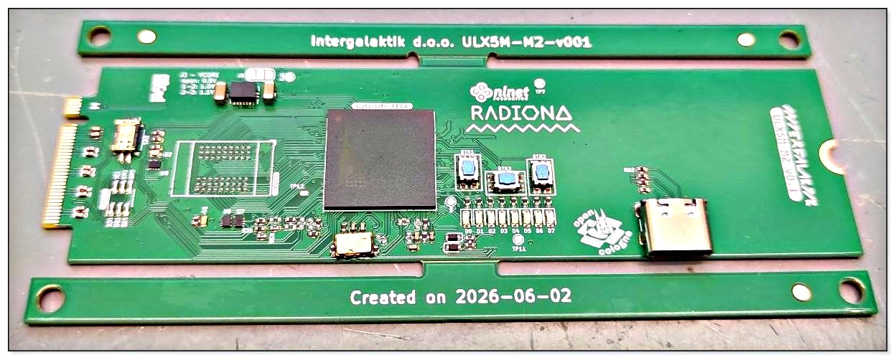
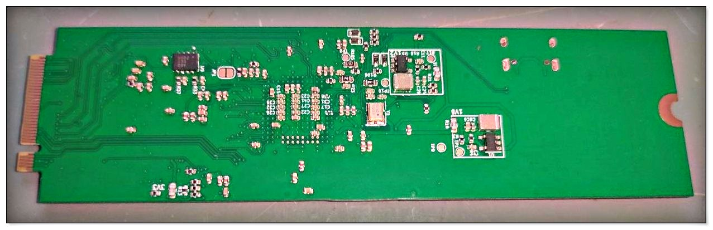
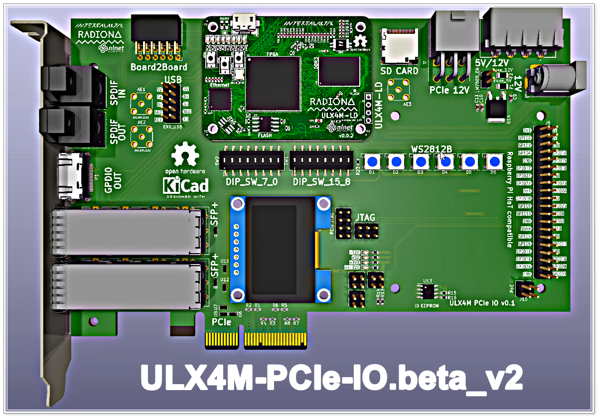
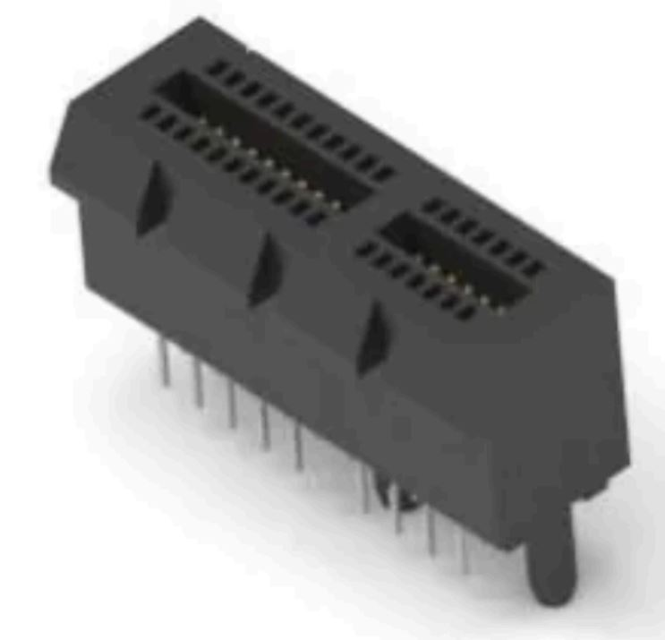
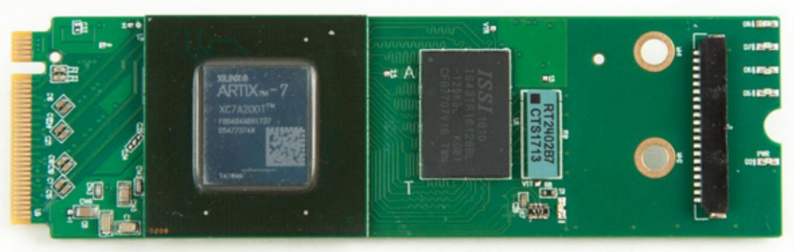
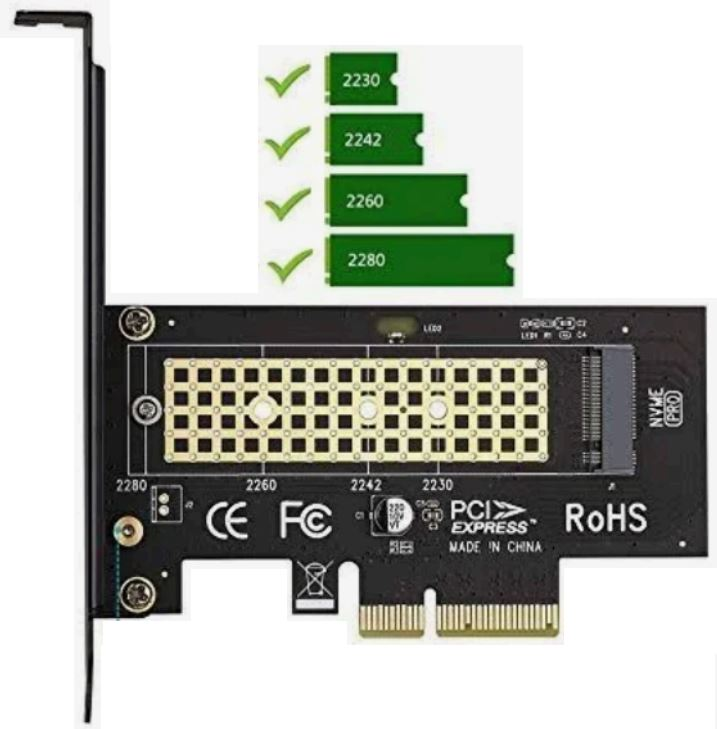
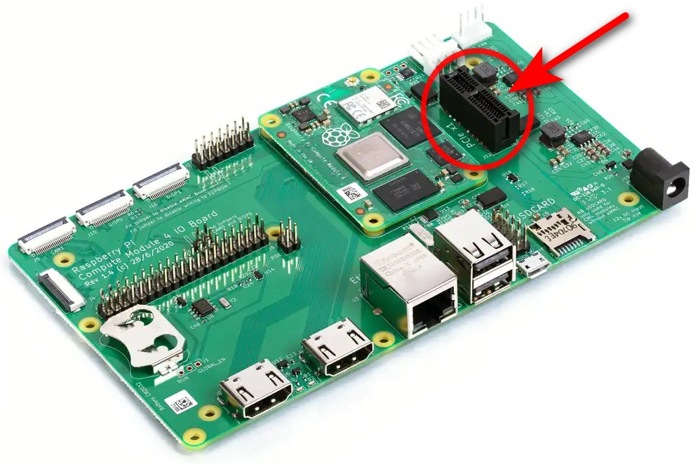
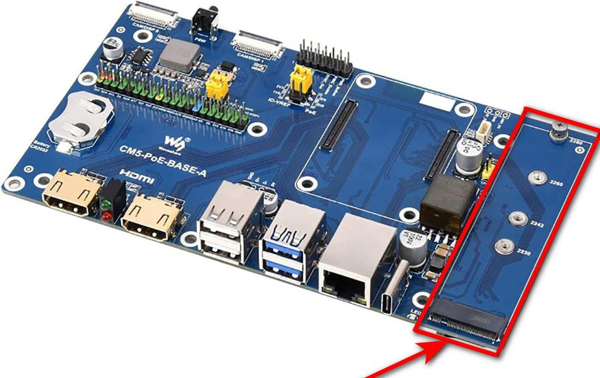
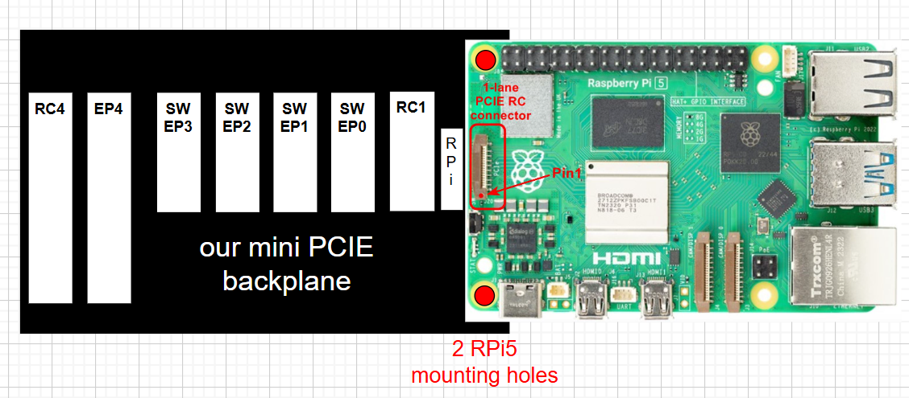

# PCB Description

This is work area for the PCB-related thoughts and explanations, including the steps and results for conducting high-speed [openEMS](https://docs.openems.de) simulations.

### M2 card

   

  
  
  

For additional detail, check the source repo:
 - [x] https://github.com/intergalaktik/ulx5m-m2

  
### Edge card
Just for illustration, and to get the ball rolling, here is an earlier attempt at PCIE "Slot" EndPoint card. Stay tuned for more...

  

### Form factors and hosts

The PCB part of the project shall deliver two cards: GateMate in **(i) PCIE "Slot"** and **(ii) M.2** form-factors

  
  

While the "Slot" variant is not critical, and could have been suplanted by one of the ready-made M.2-to-Slot adapters, 

  

it is more practical not to have an interposer. "Slot" is still the dominant PCIE form-factor for desktops and servers. The M.2 is typically found in the laptops. Initially, we will use the existing [CM4 ULX4M](https://github.com/intergalaktik/ULX4M) with off-the-shelf I/O boards:

  
  

When our two new plug-in boards become available, the plan is to gradually switch thedev platform to our openPCIE backplane, which features:
- Slots on one side
- M.2s on the other
- RootComplex also as a plug-in card (as opposed to the more typical soldered-down), for interoperability testing with [RaspberryPi](https://www.raspberrypi.com) and Xilinx Artix-7 .
- on-board (soldered-down) PCIE Switch for interoperability testing of the most typical EP deployment scenario, which is when RootPort is not directly connected to EndPoints, but goes through a Switch.

  

#### References:
- [GateMate Evaluation Board, DS1003](../0.doc/1.pcb/ds1003-GateMate-EVB-datasheet.Jan2024.pdf) and its [schematics, rev 3v2](../0.doc/1.pcb/ds1003-GateMate-EVB-3v2-schematics.Jan2024.pdf) by Cologne Chip, January 2024: the board of the SerDes PRBS test
- [GateMate A2 GPIO Bank Allocation, UG1004](../0.doc/1.pcb/ug1004-GateMate-A2-GPIO-allocation.Jun2025.pdf) by Cologne Chip, June 2025
- [USB3 PHY for GateMate](https://nlnet.nl/project/GateMate-USB3-PHY)
- [KiCad and openEMS](https://www.youtube.com/watch?v=VcJqhsbzR3c)
- [Automated PCB trace selection for SI simulation](https://antmicro.com/blog/2024/07/automated-pcb-trace-selection-for-si-simulation)
- [ULX4M-PCIe-IO](https://github.com/intergalaktik/ULX4M-PCIe-IO)
- [openPCIE Backplane](https://github.com/chili-chips-ba/openPCIE/tree/main/1.pcb)
- [NiteFury-and-LiteFury](https://github.com/RHSResearchLLC/NiteFury-and-LiteFury)
- [4-port M.2 PCIE Switch](https://github.com/will127534/CM4-Nvme-NAS)
- [AntMicro EMS Sim](https://antmicro.com/blog/2025/07/recent-improvements-to-antmicros-signal-integrity-simulation-flow)
- [openEMS](https://docs.openems.de)

--------------------
#### End of Document
