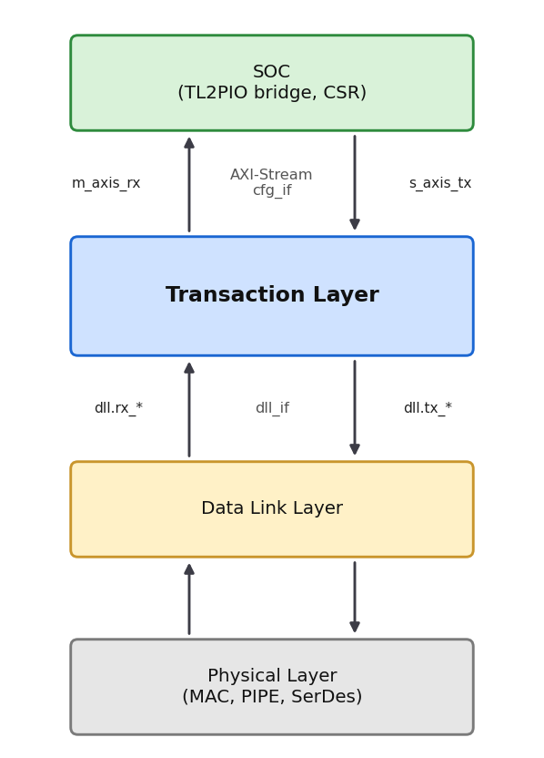
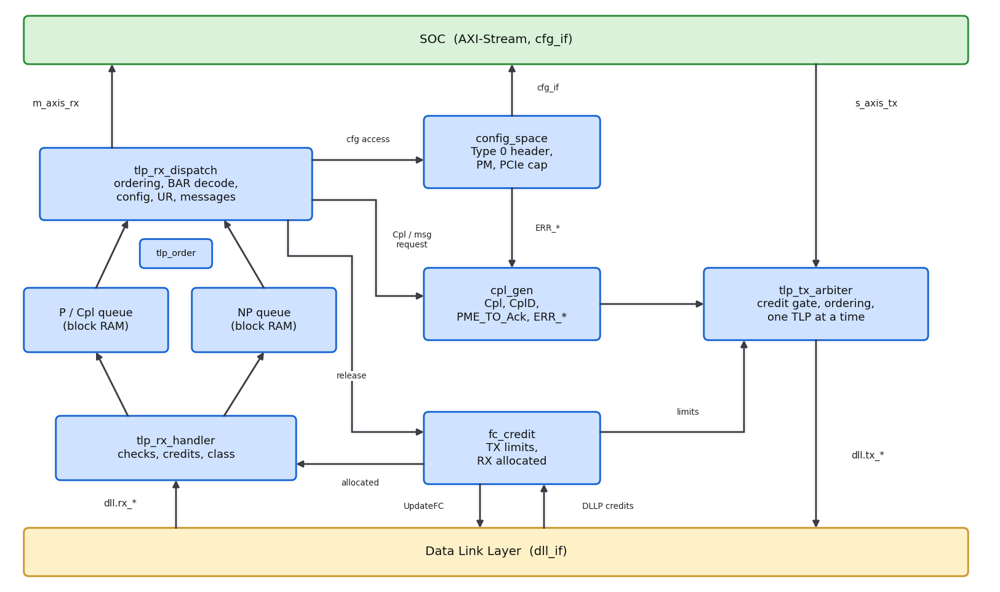
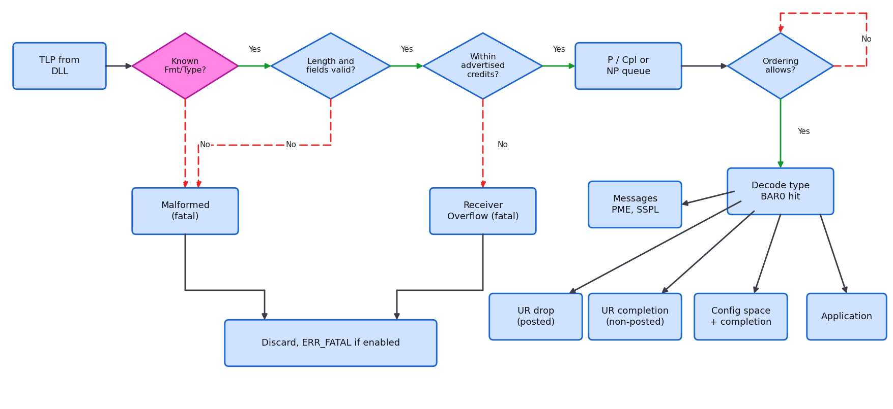
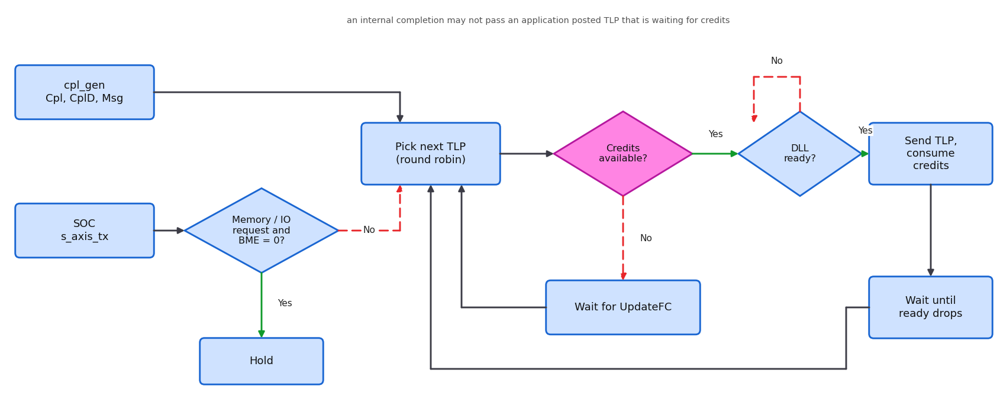
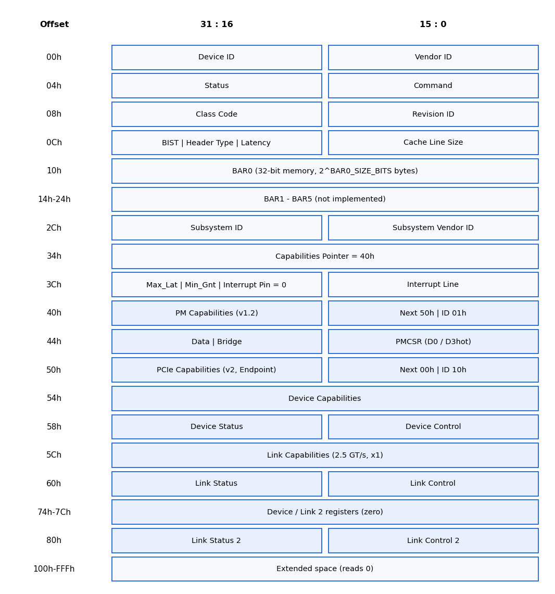

# PCIe Transaction Layer (TL)

## Description
The **Transaction Layer (TL)** sits between the SOC above and the **Data Link Layer (DLL)** below. It is the layer that knows what a TLP means: it checks every received TLP, keeps the receive buffers within the flow-control credits it advertised, answers configuration requests from its own configuration space, sends Unsupported Request completions, handles the messages an Endpoint has to handle, and forwards memory requests that hit its BAR to the SOC. In the transmit direction it merges its own completions and messages with the TLPs of the SOC and only sends a TLP when the link partner has the credits for it.

The TL is an Endpoint, function 0, single virtual channel (VC0), with one 32-bit memory BAR. Its user interface is the one of the AMD `PCIE_2_1` hard block in EP mode ([UG477](../../0.doc/2.rtl/ug477_7Series_IntBlock_PCIe.pdf)): TLPs as two 64-bit AXI-Stream streams, and the `cfg` sideband. It follows the PCI Express Base Specification 2.1.



## Architecture



- **pcie_tl**: the top. It connects the blocks below to `dll_if`, the two AXI-Stream streams and `cfg_if`, swaps the byte order at the DLL boundary, and takes DL_Up from the DLL state.
- **tlp_rx_handler**: takes TLPs from the DLL, decodes the header, checks it and writes the TLP into the posted/completion queue or the non-posted queue. A TLP is committed only after its last word has been received and all checks passed; otherwise it is discarded.
- **tlp_queue**: TLP buffer in block RAM. Two words of the head TLP are held in registers, so the header can be decoded before the TLP is taken out of the queue.
- **tlp_order**: remembers, for every non-posted TLP, how many posted TLPs were received before it, and releases the head of the non-posted queue once all of them are done.
- **tlp_rx_dispatch**: takes TLPs out of the two queues in an order the ordering rules allow, decodes them and executes them: configuration access, forwarding to the SOC, Unsupported Request, message handling. When a TLP has been consumed, its credits are released.
- **config_space**: Type 0 configuration header, PCI Power Management capability and PCI Express capability, error status and error message requests.
- **cpl_gen**: builds Cpl and CplD for configuration requests and Unsupported Requests, and the PME_TO_Ack, ERR_NONFATAL and ERR_FATAL messages.
- **tlp_tx_arbiter**: chooses between `cpl_gen` and the SOC, checks the transmit credits, and streams one TLP at a time to the DLL.
- **fc_credit**: credit limits of the link partner (from InitFC1, InitFC2 and UpdateFC), credits consumed by the TL, credits allocated to the link partner, and UpdateFC requests to the DLL.
- **tl_pkg**: the types of the TL, the header decoder (`tlp_kind`, `tlp_class`, `tlp_words`, ...) and the configuration registers as structs. The TLP header fields themselves are the structs of [`pcie_pkg`](pcie_pkg.sv).

## The Interface

| Port        | Type             | Description                                   |
|:----------- |:---------------- |:--------------------------------------------- |
| `clk`       | `input logic`    | PCLK                                          |
| `rst_n`     | `input logic`    | `core_rst_n`, asynchronous, active low        |
| `dll`       | `dll_if.tl`      | the Data Link Layer                           |
| `s_axis_tx` | `axis_if.slave`  | TLPs from the SOC (tuser: `pcie_tx_tuser_t`)  |
| `m_axis_rx` | `axis_if.master` | TLPs to the SOC (tuser: `pcie_rx_tuser_t`)    |
| `cfg`       | `cfg_if.core`    | status sideband to the SOC                    |

### Byte order
On `dll_if` byte 0 of a TLP is `[7:0]` of the first word, the order in which the DLL sends it. On the AXI-Stream side the order is the one of UG477 and `pcie_pkg`: header DW0 in `[31:0]`, DW1 in `[63:32]`, and byte 0 of every DW, payload included, in `[31:24]`. `pcie_tl` swaps the bytes of every DW at the DLL boundary (`trn_byte_swap`), so the whole TL works in this order and reads the header through the `pcie_pkg` structs.

### Data Link Layer (dll_if)
- **DL_Up** is `dl_state` in DL_Init FC_INIT2 or DL_Active, registered. While DL_Up is low the TL is held in reset: DL_Down is handled as a reset of the TL, as required for an upstream port.
- **TLPs**: the TL starts a TLP only while `tx_tlp_ready` is high, sends it in consecutive words and then waits for `tx_tlp_ready` to drop before it looks at the next one. This matches the DLL retry buffer, which holds one TLP. The last word of a TLP with an odd number of DWs is marked with `tx_tlp_last_half`, the DLL's `tl_tx_tlp_last_half` ([#21](https://github.com/chili-chips-ba/openCologne-PCIE/issues/21)): the DLL then sends only its lower 4 bytes.
- **DLLPs**: the TL asks the DLL for UpdateFC DLLPs (`tx_packet_type` is always UpdateFC) and takes the credits of the InitFC1, InitFC2 and UpdateFC DLLPs the DLL receives.

One gap on the DLL side is open in [gatemate-pipe](https://github.com/colognechip/gatemate-pipe):
- [#22](https://github.com/chili-chips-ba/openCologne-PCIE/issues/22): the DLL sends InitFC1 and InitFC2 with fixed credits (P 32/1008, NP 32/1, Cpl infinite); its `INIT_*` parameters set only the UpdateFC values. The `INIT_*` parameters of the TL have to be the ones the DLL sends; until the DLL builds its InitFC DLLPs from them, the two do not match.

### SOC (AXI-Stream and cfg_if)
- **m_axis_rx** carries the memory reads and writes that hit BAR0, and all completions. `tkeep` is `8'hFF`, and `8'h0F` on a last beat that holds one DW. `tuser.bar_hit[0]` marks BAR0 (0 for completions), `tuser.err_fwd` a poisoned TLP, `tuser.ecrc_err` is 0.
- **s_axis_tx** takes TLPs from the SOC. A TLP starts with the beat after `tlast`; the TL takes the credit type and the length from the header, so `tkeep` and `tuser` are not used. Memory and I/O requests from the SOC are held until Bus Master Enable is set.
- The SOC has to answer every memory read with a completion, with `{cfg.bus_number, cfg.device_number, 3'b000}` as Completer ID. Completions are advertised with infinite credits, so they are always taken from the link; a SOC that issues requests has to keep accepting their completions.
- **cfg**: `bus_number` and `device_number` are captured from Type 0 configuration writes, `function_number` is 0, `tx_buf_avail` is 1 while the DLL can take a TLP, `msg_err_fatal` is 0 (an Endpoint does not receive ERR_FATAL).

### Parameters
| Parameter          | Default        | Description                                          |
|:------------------ |:-------------- |:---------------------------------------------------- |
| `VENDOR_ID`        | `16'h1234`     | Vendor ID                                            |
| `DEVICE_ID`        | `16'h0001`     | Device ID                                            |
| `REVISION_ID`      | `8'h00`        | Revision ID                                          |
| `CLASS_CODE`       | `24'hFF0000`   | Class Code                                           |
| `SUBSYS_VENDOR_ID` | `16'h1234`     | Subsystem Vendor ID                                  |
| `SUBSYS_ID`        | `16'h0001`     | Subsystem ID                                         |
| `BAR0_SIZE_BITS`   | `12`           | BAR0 size is `2^BAR0_SIZE_BITS` bytes                |
| `INIT_PH`          | `8'd8`         | Posted header credits advertised                     |
| `INIT_PD`          | `12'd32`       | Posted data credits advertised                       |
| `INIT_NPH`         | `8'd8`         | Non-posted header credits advertised                 |
| `INIT_NPD`         | `12'd8`        | Non-posted data credits advertised                   |
| `P_ADDR_W`         | `7`            | Posted/completion queue depth, `2^n` words           |
| `NP_ADDR_W`        | `6`            | Non-posted queue depth, `2^n` words                  |
| `ASPM_SUPPORT`     | `2'b01`        | Link Capabilities ASPM Support (L0s)                 |
| `L0S_EXIT_LATENCY` | `3'b111`       | Link Capabilities L0s Exit Latency                   |
| `L1_EXIT_LATENCY`  | `3'b111`       | Link Capabilities L1 Exit Latency                    |
| `L0S_ACCEPT_LAT`   | `3'b111`       | Device Capabilities Endpoint L0s Acceptable Latency  |
| `L1_ACCEPT_LAT`    | `3'b111`       | Device Capabilities Endpoint L1 Acceptable Latency   |
| `SLOT_CLOCK`       | `1'b1`         | Link Status Slot Clock Configuration                 |

`pcie_core` instantiates `pcie_tl` with these defaults.

## Receive path



### Checks
Every received TLP is checked before it is committed to a queue. A failed check discards the TLP.

| Check                                                                  | Result                     |
|:---------------------------------------------------------------------- |:-------------------------- |
| Fmt/Type is not a defined TLP type                                     | Malformed TLP              |
| Number of words does not match the header (Length, TD)                 | Malformed TLP              |
| Payload larger than Max_Payload_Size                                   | Malformed TLP              |
| Configuration or I/O request with TC, Attr, Length or Last BE not as required | Malformed TLP       |
| Set_Slot_Power_Limit not on TC0                                        | Malformed TLP              |
| TLP exceeds the credits allocated to the link partner                  | Receiver Overflow          |

The digest of a TLP with TD set is not checked (no ECRC support); it is accounted for in the length.

### Queues and ordering
Posted requests and completions go to one queue, non-posted requests to the other. `tlp_order` lets a non-posted TLP go only after all posted TLPs received before it, so a non-posted request never passes a posted one. Posted requests and completions are never held back by a waiting non-posted request: if the head of the non-posted queue cannot be served, for example because the SOC is not ready, the posted queue keeps going.

### What happens to a TLP
| TLP                                         | Action                                                      |
|:------------------------------------------- |:----------------------------------------------------------- |
| CfgRd0 / CfgWr0 to function 0               | Configuration access, CplD / Cpl with Successful Completion |
| CfgRd0 / CfgWr0 to another function         | Cpl with Unsupported Request                                |
| CfgWr0 with poisoned data                   | Not written, Cpl with Unsupported Request                   |
| CfgRd1 / CfgWr1, IORd / IOWr, MRdLk, AtomicOp | Cpl with Unsupported Request                              |
| MRd that hits BAR0                          | To the SOC                                                  |
| MRd that misses BAR0                        | Cpl with Unsupported Request                                |
| MWr that hits BAR0                          | To the SOC                                                  |
| MWr that misses BAR0, or is poisoned        | Discarded, Unsupported Request                              |
| PME_Turn_Off                                | PME_TO_Ack sent                                             |
| Set_Slot_Power_Limit                        | Value and scale copied to Device Capabilities               |
| Unlock, PM_Active_State_Nak, Vendor_Defined Type 1, Ignored Messages | Discarded                          |
| Any other message                           | Discarded, Unsupported Request                              |
| Cpl / CplD                                  | To the SOC, `err_fwd` if poisoned                           |

BAR0 hits require Memory Space Enable and the function in D0. For an Unsupported Request completion to a memory read, Byte Count and Lower Address are calculated from Length, the byte enables and the address, as for a successful completion (Tables 2-31 and 2-32 of the specification). For an Unsupported Request completion to an AtomicOp, Byte Count is the operand size. For all other completions Byte Count is 4 and Lower Address is 0.

## Transmit path



The arbiter alternates between `cpl_gen` and the SOC. A TLP is sent only if every credit type it needs passes the gating test of section 2.6.1.1:

`(CREDIT_LIMIT - (CREDITS_CONSUMED + needed)) mod 2^[Field Size] <= 2^[Field Size] / 2`

Credit types that were advertised as 0 in InitFC are infinite and always pass. An internal completion is not sent ahead of a posted TLP of the SOC that is waiting for credits.

## Flow control
- **Transmit**: the credit limits are taken from the first InitFC1 or InitFC2 of each credit type, then from UpdateFC. They are kept during DL_Init and cleared while the DLL is in DL_Inactive.
- **Receive**: `CREDITS_ALLOCATED` starts at `INIT_*` and grows when a TLP leaves the queue, either consumed by the TL or accepted by the SOC. Every release of posted or non-posted credits sends an UpdateFC with the new value. The periodic UpdateFC every 30 µs is sent by the DLL with the last value it received.

## Configuration space



| Register                 | Notes                                                                                   |
|:------------------------ |:--------------------------------------------------------------------------------------- |
| Command                  | I/O Space, Memory Space, Bus Master, Parity Error Response, SERR# Enable are writable   |
| Status                   | Capabilities List set; Signaled System Error and Detected Parity Error are RW1C        |
| BAR0                     | 32-bit, non-prefetchable memory, `2^BAR0_SIZE_BITS` bytes                               |
| PMCSR                    | D0 and D3hot; writes of D1/D2 are ignored; No_Soft_Reset set                            |
| PCI Express Capabilities | Version 2, PCI Express Endpoint                                                         |
| Device Capabilities      | Max_Payload_Size 128 bytes, Role-Based Error Reporting, Captured Slot Power Limit       |
| Device Control           | Error reporting enables, Relaxed Ordering, Max_Payload_Size, No Snoop, Max_Read_Request_Size |
| Device Status            | Non-Fatal, Fatal and Unsupported Request Detected are RW1C                              |
| Link Capabilities        | 2.5 GT/s, x1, ASPM support and exit latencies are parameters                            |
| Link Control / Link Control 2 | ASPM Control, RCB, Common Clock, Extended Synch / Target Link Speed and the test fields |

Each register is one 32-bit word with a write mask (and an RW1C mask where needed), merged with the byte enables of the configuration write (`cfg_write_merge`, `cfg_w1c` in `tl_pkg`). The Bus and Device Number are captured from every Type 0 configuration write to function 0, before its completion is built, and are used as Completer ID and Requester ID.

## Error handling
The function has no Advanced Error Reporting, so errors are handled as in Figure 6-2 of the specification for a function without AER.

| Error                                    | Severity            | Device Status            | Message, if enabled |
|:---------------------------------------- |:------------------- |:------------------------ |:------------------- |
| Malformed TLP                            | Fatal               | Fatal Error Detected     | ERR_FATAL           |
| Receiver Overflow                        | Fatal               | Fatal Error Detected     | ERR_FATAL           |
| Unsupported Request, posted              | Non-Fatal           | Non-Fatal, UR Detected   | ERR_NONFATAL        |
| Unsupported Request, completion sent     | Advisory Non-Fatal  | not logged               | none                |
| Poisoned TLP received                    | —                   | Status: Detected Parity Error | —              |

ERR_FATAL is sent when Fatal Error Reporting Enable or SERR# Enable is set. ERR_NONFATAL for an Unsupported Request is sent when (Unsupported Request Reporting Enable or SERR# Enable) and (Non-Fatal Error Reporting Enable or SERR# Enable) are set. Sending either message with SERR# Enable set sets Signaled System Error.

## Simulation
[`sim/tb_pcie_tl.sv`](sim/tb_pcie_tl.sv) tests `pcie_tl` on its own, through its interfaces. The test bench plays the DLL on `dll_if` (it injects TLPs and DLLPs in the DLL byte order, steps `dl_state` through DL_Init, and takes the TLPs the TL sends, with the `tx_tlp_ready` behaviour of the DLL retry buffer), the Root Complex that issues the requests, and a PIO application with a memory behind BAR0 on the AXI-Stream side. It runs on Verilator; Icarus Verilog does not take interfaces as module ports.

```sh
cd 2.rtl/5.tlp/sim
bash run-tl.sh              # whole test, about a minute with the Verilator build
bash run-tl.sh --seed 7     # other random sequence in step 19
bash run-tl.sh --dump       # with a waveform
```

Build products and the waveform go to `$SERDES_BUILD_DIR/tl` (default `~/.cache/opencologne-pcie`).

| Step | What is checked                                                                          |
|:---- |:---------------------------------------------------------------------------------------- |
| 1    | Flow control initialization, first configuration read with Completer ID 0                |
| 2    | Bus number capture, BAR0 sizing and assignment                                            |
| 3    | Capability list: PM, PCI Express, Device and Link registers, extended space             |
| 4    | Memory read with Memory Space disabled, Unsupported Request completion                    |
| 5    | Memory writes and reads through the SOC, 1 and 4 DWs, 64-bit address                    |
| 6    | Unsupported requests with completion: BAR miss, other function, Type 1, I/O, MRdLk, AtomicOp, Byte Count and Lower Address |
| 7    | Posted Unsupported Request, Device Status, ERR_NONFATAL                                 |
| 8    | Malformed TLPs, ERR_FATAL                                                                |
| 9    | PME_Turn_Off and PME_TO_Ack, Set_Slot_Power_Limit, discarded and unsupported messages   |
| 10   | Poisoned configuration write                                                             |
| 11   | UpdateFC values for all credits released so far                                          |
| 12   | A non-posted request waits for an earlier posted request                                 |
| 13   | A posted request passes a non-posted request that is waiting for the SOC                |
| 14   | Receiver Overflow                                                                        |
| 15   | TLP with digest                                                                           |
| 16   | Completions forwarded to the SOC, `err_fwd` for a poisoned CplD                           |
| 17   | D3hot disables Memory Space                                                                |
| 18   | SOC requests are held until Bus Master Enable                                             |
| 19   | 80 random memory writes and reads with random back-pressure from the SOC, credits respected as the DLL would |
| 20   | DL_Down resets the TL, transmit stops at the completion credit limit and resumes after UpdateFC |

On every beat of `m_axis_rx` the test bench also checks `tkeep` against the length in the header, and that `ecrc_err` is 0.

## References
- [PCI Express Base Specification Revision 2.1](../../0.doc/PCIE-base-spec.Rev2-1.pdf)
- [PCIe Primer by Simon Southwell](../../0.doc/pcie-primer.Simon-Southwell.pdf)
- [UG477, 7 Series FPGAs Integrated Block for PCI Express](../../0.doc/2.rtl/ug477_7Series_IntBlock_PCIe.pdf)
- [DLL - TL interface](../0.doc/260511-TL_DPLL-gatemate.pdf)
- [Data Link Layer](../4.dll/README.md)
