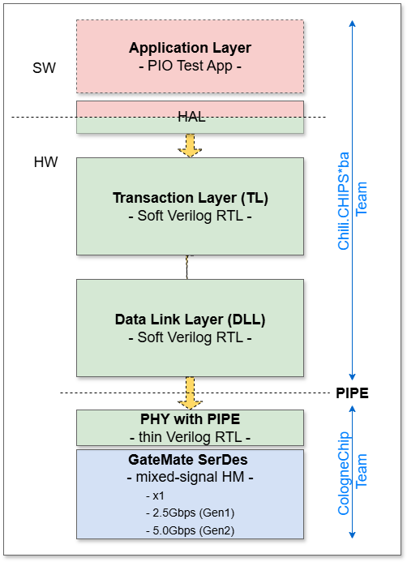
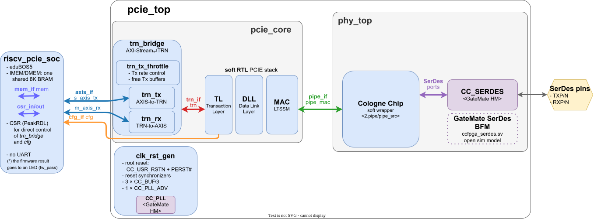

# RTL Architecture

**[WIP]**

At the moment, this section is merely a scratchpad of our thoughts and ideas, team comments and suggestions..., from which we seek to define the structure, interfaces, partitioning...

**This is also an open, community-wide invite to contribute to this creation process.**

  

### HW/SW Architecture

  

### Compatibility goal: an Artix-7 EndPoint, in open source

To its user, our EP looks exactly like the AMD Artix-7 EP, the `PCIE_2_1` hard macro in EndPoint mode. The TRN / AXI-Stream user interface is kept as-is, and the soft TL answers configuration requests itself, as the hard macro does. Code written for the Artix-7 EP should port with no changes to the user interface. When in doubt about how something should behave, [UG477](../0.doc/2.rtl/ug477_7Series_IntBlock_PCIe.pdf) is the reference.

### Porting plan: openPCIE → openCologne-PCIE

[openPCIE](https://github.com/chili-chips-ba/openPCIE) (Root Complex, Artix-7) and openCologne-PCIE (EndPoint, GateMate) are twins. We keep the openPCIE structure and replace only what is vendor-specific:

| openPCIE (Artix-7 RC) | openCologne-PCIE (GateMate EP) |
|---|---|
| `PCIE_2_1` hard macro: TL, DLL, LTSSM, MAC | our soft RTL: TL ([5.tlp](5.tlp)), DLL ([4.dll](4.dll)), MAC/LTSSM ([3.mac](3.mac)) |
| `phy_top`: `mac2phy` + GTP wrapper + `GTPE2` hard macros | `phy_top`: Cologne Chip soft wrapper ([2.pipe](2.pipe)) + GateMate SerDes `CC_SERDES` ([1.phy](1.phy)), with the open [SerDes BFM](1.phy/2.serdes-model) for simulation |
| `trn_if`, `axis_if`, `cfg_if`, `pcie_pkg` | the same ([5.tlp](5.tlp)) |
| SOC `riscv_pcie_soc` + PeakRDL CSR | the same ([6.soc](6.soc)), with the Rx window capturing any TLP, as an EP must see Memory requests |
| eduBOS5 RISC-V core | fetched from openPCIE, not copied ([`4.build/fetch-edubos5.sh`](../4.build/fetch-edubos5.sh)) |
| co-sim VIP: VProc, pcieVHost as the EP, rv32 ISS | the same in [5.sim](../5.sim), pcieVHost as the RC; rv32 ISS fetched from upstream, not copied |
| C firmware: the RC enumerates and tests the EP | C firmware: the EP answers the host's Memory requests |

Only the C firmware changes in role; the user interface, the SOC and the VIP stay the same. Everything is open source, so there is no split between vendor and open RTL.

#### References:
- [PCIE Primer](../0.doc/pcie-primer.Simon-Southwell.pdf) by Simon Southwell ✔
- [PCIE Technology Rev3.0 (MindSharePress2012)](https://github.com/chili-chips-ba/openCologne-PCIE/blob/main/0.doc/PCIE-Technology3-0---MindSharePress2012.pdf)
- [PCIE Base Spec Rev2.1](https://github.com/chili-chips-ba/openCologne-PCIE/blob/main/0.doc/PCIE-base-spec.Rev2-1.pdf)
- [GateMate FPGA Datasheet, DS1001](../0.doc/2.rtl/ds1001-GateMate-datasheet.Sep2026.pdf) by Cologne Chip, September 2026
- [GateMate FPGA Primitives Library, UG1001](../0.doc/2.rtl/ug1001-GateMate-primitives-library.Mar2025.pdf) by Cologne Chip, March 2025: `CC_PLL`, `CC_DFF`, `CC_BUFG`, `CC_USR_RSTN`, `CC_SERDES`
- [GateMate Integrated Logic Analyzer, UG1005](../0.doc/2.rtl/ug1005-GateMate-ILA.Aug2025.pdf) by Cologne Chip, August 2025: on-chip debug
- [7 Series FPGAs Integrated Block for PCI Express, UG477](../0.doc/2.rtl/ug477_7Series_IntBlock_PCIe.pdf) by AMD/Xilinx: the user interface (TRN / AXI-Stream, configuration space) our EP reproduces; the reference whenever in doubt

  
#### Examples:

Proprietary PCIE Core for Xilinx 7Series FPGA devices
  - [Xilinx UG477 7series PCIE HM - User Guide](https://docs.amd.com/v/u/en-US/ug477_7Series_IntBlock_PCIe) ✔
  - [Xilinx PG054 7series PCIE HM - Product Guide](https://www.xilinx.com/support/documents/ip_documentation/pcie_7x/v3_3/pg054-7series-pcie.pdf)
  - [Xilinx DS821 7series PCIE HM - Datasheet](https://docs.xilinx.com/v/u/en-US/ds821_7series_pcie)
> The Xilinx 7-series FPGAs Integrated block (HM, Hard Macro) for PCIE sits in a similar space as the _openCologne-PCIE_ project goals, except that it is more comprehensive and configurable, with more options (e.g. root complex mode, multi-lanes etc.). It does serve, though, as an indicator of the complexity of requirements if _openCologne-PCIE_ is to be a viable open-source alternative.
>
> The links below are examples of open-source **applications** built around vendor PCIE Hard-Macros (HM), such as this Xilinx _pcie_7x_ core. 
> - [regymm pcie_7x](https://github.com/regymm/pcie_7x)
> - [LiteFury pcie_7x](https://github.com/hdlguy/litefury_pcie)
> - [wavelet-lab pcie_7x wrappers, with DMA](https://github.com/wavelet-lab/usdr-fpga/tree/main/lib/pci)
> - [Wupper DMA for Xilinx PCIE HMs](https://gitlab.nikhef.nl/franss/wupper)
> - [Alex's wrappers for Xilinx and Altera PCIE HMs, with DMA](https://github.com/alexforencich/verilog-pcie)
> - [LitePCIE wrappers for vendor (Xilinx, Gowin, Lattice, ...) PCIE HMs](https://github.com/enjoy-digital/litepcie)
>
> It must be noted here that there is a common misconception about these projects. They are not open-source PCIE cores, but rather the examples of how to use the proprietary cores. Our project is unique in that sense, and currently the only open-source work which is about creating a PCIE core itself. 

# Quick walkthrough the PIO MemWr, MemRd process

In order to sub-divide the DLL and TL into implementable design blocks, we need to first work out what goes on inside of them for a PIO memory write and read. We start by identifying the minimum functionality of each layer, yet one that still does something useful and can be simulated. We will then later on built upon it, add new features and construct regression tests. The goal is to mitigate risk and buy time for the LTSSM / PHY development. This desrisking is by the virtue of initially eliminating the configuration space, link training, and DLL flow control initialization.

With the right configuration settings, the _pcievhost_ can be used to exercise (in simulation) this [minimum TL + minimum DLL + PHY_MAC] independently from the [PHY_PIPE] block. Both dev tracks can therefore go on in parallel. With these two functions already partially tested, the follow on integration is simplified and hastened. The _pcievhost_ open-source VIP also gains from it, as it will now get new options (bypass DLL initialization; disable TLP CRC checks; the model already works without link training). Those are useful verification features. 

The following two sections describe the process of (i) receiving a 32-bit `MemWr Request` and (ii) receiving a 32-bit `MemRd Request` with the return of `Completion` with a 32-bit data payload. Both the `RX and TX side` of each layer are covered. This simplifed process does not require link training, DLL initialization or flow control to be implemented (though some simple new configuration features need to be added to _pcievhost_).

## (i) Reception of a `MemWr` Request

This is a `Posted` transaction... which, from the Root Complex perspective, means fire-and-forget -- Send a request and don't wait for a response. 

#### RX data path

`RX_PHY_MAC` 
   - Pass through PIPE data/K bits to DLL

`RX_DLL`
   - Remove **STP** and **END** framing on data from PHY
   - Upon receiving **END**, instruct TX_DLL to return **ACK** (no LCRC check, always assume good)
       - CRC is kept at 0
   - No tracking of flow control credits (assume infinite credits for all flow control types)
   - Pass de-framed data to TLP (with first and last bits)

`RX_TLP`
   - Check is a _MemWr_ type?
   - Extract Address, Length, Last_BE (lbe) and First_BE (fbe)
   - Delete header words
   - Pass Payload with Addr, fbe and lbe over RX_TLP_IF (which is TBD)

#### TX data path: generate ACK

`TX_TLP`
   - Nothing

`TX_DLL`
   - Generate **ACK** DLLP to TX_PHY_MAC when told so (which is upon receiving **END**)

`TX_PHY_MAC`
   - Pass DLLPs through to TX_PHY_PIPE data/K bit interface

## (ii) Reception of a `MemRd` Request and Completion

This is a `Non-posted` transaction. It requires a `Completion` packet in response, meaning the sender must wait for a reply. It is therefore a slower operation, and considered more complicated than the MemWr.  

#### RX data path

`RX_PHY_MAC` [same operations as for the MemWr] 

`RX_DLL` [same operations as for the MemWr] 

`RX_TLP`
   - Check is a MemRd type?
   - [same: Extract Address, Length, Last_BE (lbe) and First_BE (fbe)]
   - **Extra-for-MemRd**: Extract Requester_ID (RID) and Tag
   - [same: Delete header words]
   - [same: Pass Addr, fbe and lbe over RX_TLP_IF]
   - **Extra-for-MemRd**: Pass RID and Tag

#### Tx data path: Complete _MemRd_ request

`TX_TLP`
   - Construct completion header with
      - CPL_TYPE (01010b)
      - Length in 32-bit words (1)
      - Completer_ID (CID), fixed at 0
      - Completion status of Successful Completion (000b)
      - byte_count (4)
      - Requester_ID as received with MemRd request
      - Tag received with MemRd request
      - Lower address (bottom 7 bits of received MemRd address, aligned to 32-bits)
   - Send completion data and header over TX_TLP_IF

`TX_DLL`
   - Frame completion packet from TLP with **STP** and **END** and send to PHY TX data channel
     
`TX_PHY_MAC`
   - Receive completion PIPE data and K bits from DLL and pass through to TX data channel of PIPE

## 1) TL_IF
### Features and Support

#### TLP generation and reception

| Feature | RX  support| TX support| Notes |
|---------|----|----|-------|
| Memory Reads 32 bit TLPs        | ✔yes     | stage 2  | Must support reception       |
| Memory Reads 64 bit TLPs        | ✘ no    | stage 2  | Must support reception       |
| Memory Writes 32 bit TLPs       | ✔yes     | stage 2  | Must support reception       |
| Memory Writes 64 bit TLPs       | ✘ no   | stage 2  | Must support reception       |
| Memory Reads Locked 32 bit TLPs | ✘ no      | stage 2? | Might not be required at all |
| Memory Reads Locked 64 bit TLPs | ✘ no      | stage 2? | Might not be required at all |
| I/O Reads TLPs                  | ✘ no      | ✘ no       | Legacy                       |
| I/O Writes TLPs                 | ✘ no      | ✘ no       | Legacy                       |
| Config Space 0 Reads            | ✔yes     | ✘ no       | Must support reception       |
| Config Space 0 Writes           | ✔yes     | stage 2  | Must support reception       |
| Config Space 1 Reads            | ✘ no      | ✘ no       | RCs and Switches only        |
| Config Space 1 Writes           | ✘ no      | ✘ no       | RCs and Switches only        |
| Messages                        | yes?    | yes?     | What to do with received power messages? Generation of legacy interrupts messages? Generation of error messages required |
| Completions                     | stage 2 | ✔ yes      | TX to respond to non-posted requests. TX of "unsupported request" completions for non-supported TLP types received |
| Completions with data           | stage 2 | ✔ yes      | same as above with data |
| Part completions with data      | ???     | ???      | Splitting of returned burst data. Uplink may have set a maximum payload, but request a large read |
| Completions for locked memory   | ✘ no      | ✘ no       | TX to respond to non-posted requests. TX of "unsupported request" completions for non-supported TLP types received |
| Completions with data           | ✘ no      | ✘ no       | same as above with data |

Note that, when generating a memory request (not first delivery stage) if an address used is &lt; 2^32 a 32-bit TLP _must_ be used.

#### Other internal features

| Feature | support| Notes |
|---------|-------|-------|
| Construction of TLP headers | ✔ yes | 3DW and 4DW |
| Decode of TLP headers | ✔ yes | |
| 32-bit CRC generation/check | ✔ yes | |
| Capture of BUS and Device numbers | ✔ yes | Set on _every_ configurations write. Used to generate requester ID for non-completion TLPs or CID for completion TLPs |
| Generation on ECRC digest | ✘ no | Requires extended PCIe capabilities structure |
| Traffic classes           | ✘ no | Fix at 0 |
| Auto-generation of tags   | ✔ yes | Incrementing count for each outstanding request |
| ordering and cache coherency | ✘ no | fix attributes bits to 00b in headers |
| GEN2 address type | ✘ no | Fix at 0 |
| Error/poisoned TLP | partial | Poisoned received packets must be deleted. Optional to generate. Optional to complete with a "completer abort". |

#### Signal Composition
#### Data Flow
#### Control Flow

## 2) DLL_IF

#### DLLP generation and reception

| Feature | RX  support| TX support| Notes |
|---------|------------|-----------|-------|
| DLL link initialisation | ✔ all | ✔ all | |
| InitFC1  | ✔ all | ✔ all | For all three types: P, NP, Cpl |
| InitFC2  | ✔ all | ✔ all | For all three types: P, NP, Cpl |
| UpdateFC | ✔ all | ✔ all | For all three types: P, NP, Cpl |
| ACK      | ✔ all | ✔ all ||
| NAK      | ✔ all | ✔ all ||
| PM_Enter_L1  | ??? | ✘ no  | What to do on reception? |
| PM_Enter_L23 | ??? | ✘ no  | What to do on reception? |
| PM_Enter_Active State Request_L1  | ??? | ✘ no  | What to do on reception? |
| PM_Request_Ack | ✘ no | ??? | required if power higher layer power management supported |
| Vendor specific | ✘ no | ✘ no | |

#### Other internal features

| Feature | support| Notes |
|---------|-----|-------|
| Framing TLPs between STP and END symbols | ✔ yes | |
| Framing of DLLPs netween SDP and END symbols | ✔ yes | |
| Nullified TLPs (with EBD in place of END | ??? | Not TX. Delete on RX? |
| 16-bit CRC generation/check | ✔ yes | |
| Retry buffering | ✔ yes | Packets held until ACK'd |
| Error reporting | ✔ yes | TBD on extent. Connections to config space and generating error messages |
| Flow control and Update FC generation | ✔ yes | |
| UpdateFC timeout | ✔ yes | Maximum time since last UpdateFC (for a given type) forces an UpdateFC |

#### Signal Composition
#### Data Flow
#### Control Flow

#### other notes on DLL interface signalling

TX and RX data interfaces are required to send and receive packets, with some sort of delimiting such as a 'last' signal and/or 'start'. ACK and NAK DLLP generation I would think would be internal, but some status output if NAK'd too often. Flow control DLLP generation would also, I think, be internal, though any generics to set the size of the retry buffers would reflect in the InitFC<n>-XXX DLLPs during DLL initialisation, so these need to be available to the logic. I assume only a single virtual channel (VC0) is to be implemented. A control signal to start DLL initialisation (on, say, a 'Link_UP' transition from the PHY) and a status output to reflect DLL_down/DLL_up state).

Some additional error status signals, beyond NAK error, may be required to flag things such as buffer over- or underrun (which shouldn't happen in normal circumstances), but will be design specific and dictated by the implementation.

From the top level README.md it seems that power management isn't to be initially supported, but some hooks to detect reception of, and to generate, power management DLLPs might be good, so some control and status signals for this might be added, even if not used initially. The only other packet not covered is the Vendor specific DLLP, which is optional and has no requirement to support, except, possibly, to receive and discard---but no external interface requirements.

## 3) Physical Layer to PIPE

#### OS and Training sequence generation and reception

| Feature | RX  support| TX support| Notes |
|---------|------------|-----------|-------|
| TS1 training sequence | ✔ yes | ✔ yes | Variants with Link# and Lane# set to PAD; Link# a number and lane# set to PAD; link# a number lane# a number |
| TS2 training sequence | ✔ yes | ✔ yes | link# a number lane# a number |
| Electrical idle OS | ✔ yes | ✔ yes |
| Fast Training Sequence | ??? | ??? | Might not be needed |
| Skip OS | ✔ yes | ✔ yes | |
| IDL | ✔ yes | ✔ yes | 0 character pre-scramble and encoding |
| Compliance pattern | ✘ no | |

#### Other internal features

| Feature | support| Notes |
|---------|-----|-------|
| SKIP OS counter | ✔ yes | needs to be sent at reqular intervals (between a min and max) oonce link is up |
| NTFS | partial | TS OS needs a value set, so pick a fixed one |
| Control bits | ??? | No TX requirement. How to respond to RX with bits set? |
| Lane inversion | yes? | It is valid that a lanes diff pair are wire opposite |
| Lane reversal | ??? | May not be applicable to a single lane but if connected to a wider link, may beed to set to a deifferemt value other than 0 on training |
| LTSSM | partial | **Detect**, **polling**, **configuration**, and **L0** required. **Recovery** required to switch from GEN1 to another GEN. What to do if directed to any of the other states? |
| PIPE interface | ✔ yes | | 

## 4) PIPE
See [2.rtl/1.phy](1.phy/README.md)

## 5) Type 0 Configuration Space

### Strategies for Configuration Space Support

A configuration space is required for the device to be enumerated. Not all capabilities structures are required. The table below shows those that are needed.

| Capability                                 | required?     | Size      | Notes |
|--------------------------------------------|---------------|-----------|-------|
| Type 0 PCI compatible capabilities         | ✔ required      | 16 DWORDS | Has some dynamic fields |
| PCIe capabilities structure                | ✔ required      | 15 DWORDS | Only first 5 need implementing, rest return 0 |
| Power management capabilities              | ✔ required      |  2 DWORDS | Has some dynamic fields |
| MSI Capabilities structure                 | ✘ semi-optional |  5 DWORDS | Required if device capable of generating interrupts |
| All other capabilites/extended capabilties | ✘ optional      | N/A       | |

#### Approaches to implementation.

1. Pass config space transactions out to user logic to handle
  >- Use same i/f for other TLPs, with config space indicator
  >- Need a special interface to feedback state and get status
  >- Perhaps gives user too much to still implement
2. Fully logic implementation
  >- Generics for user to set static values and defaults
  >- Input signals to set dynamic values (need to identify which)
  >- read-only masking part of logic implementation
3. Use block RAM for majority of configuration space (896/736 bits for with MSI/without MSI))
  >- has 64 bits for each 32-bit word: lower DWORD is the value, upper word is a read only mask
  >- All writes are a read modify write operation to get value and mask and write back using mask
  >- Default settings either:
    >>- via a raw mode write sequence (ignoring masks) using default values and user set generics
    >>- set the initialisation of the RAM as part of synthesis (reset issues?)
  >- For config space reads from words with dynamic status, relevant fields default to 0 and dynamic bits ORed when reg addressed for config space read
  >- For config space writable words with control for the logic, mirror in real registers when words selected for update
    >>- includes BARs (upto 192 bits)

#### List of config space outputs to rest of logic
  - BARs
  - Max payload size (DevCtrlReg[7:5])
  - Memory space enable (CmdReg[1])
  - Bus Master Enable (CmdReg[2])
  - Parity Error Response (CmdReg[6])
  - SERR# (CmdReg[8])

## 6) 'soc_if' and TL2PIO Bridge
Add brief description of how the RTL part of TestApp interacts with the PCIE Core.

## Miscellaneous Notes

### Notes on configuration space in architecture

I don't see where in the diagram a configuration space is located unless it's part of the transaction layer or maybe there's supposed to be an interface defined for external, peripheral specific implementation? Also, I don't see where generation and detection of PHY ordered sets is done---from the blurb in the top level README.md, I assume not the thin layer RTL PHY with PIPE. If so, that suggests a partial PHY layer between the DLL layer and the thin PHY PIPE layer, that implements the LTSSM to generated training sequences and count received training sequences of the different types, and a means to regularly generate skip ordered sets (unless in the thin PHY?). I am aware that the top level README.md says _"We only support x1 (single-lane) PCIE links. The link width training is therefore omitted"_, but whatever you connect to will be in the link down state and will need training to get to the link up state. Link training is not only to set the link width and it is not optional, even for an x1 link.

#### _pcievhost_ new configuration features required

* Disable DLLP CRC checks:  **DONE**
* Disable TLP CRC checks : **DONE**
* Configurable initial upstream flow control credits: **Disabling FC already configurable and does the job**
* Pipex1 updated for wider PIPE interface to match the CologneChip: **DONE**
 

### RTL coding rules

IEEE 1800-2009 SystemVerilog, the same rules as on [openPCIE](https://github.com/chili-chips-ba/openPCIE/blob/main/2.rtl/README.md#rtl-coding-rules). For our RTL and the models that stand in for it. Code mirrored from upstream (`4.dll/dll_src`, `4.dll/sim/tb_dll_logic.v`) and the Cologne Chip submodules (`2.pipe/pipe_src`, `3.mac/mac_src`) keep their own style. `run-lint`, `run-format` and `run-leq` are openPCIE's, linked there until they are in `4.build`.

- **One place for bit positions:** TLP header fields and sideband bits are packed structs in a `_pkg` (openPCIE: [`pcie_pkg.sv`](https://github.com/chili-chips-ba/openPCIE/blob/main/2.rtl/0.common.opensource/src/pcie/pcie_pkg.sv)). Use their members, never raw slices like `tdata[30:29]`. Reserved bits are `rsvd0`, `rsvd1`, ..., so each struct spans its full width.
- **Declare and size once:** widths, constants and types live in a `_pkg` (e.g. `TRN_DATA_W` in openPCIE's `pcie_pkg.sv`); no module redeclares them.
- **Fewer, richer ports:** interfaces and struct-typed ports, not many scalars; group internal signals the same way.
- **Packages:** `import` right after the module name, no package prefix on every use.
- **Case:** signals and ports lower case, constants UPPER CASE (parameters, localparams, enum values, macros). Only vendor hard-macro and primitive pins (`CC_SERDES`, `CC_PLL`, `CC_BUFG`, ...) keep vendor names.
- **Descriptor names:** a signal of a `pcie_pkg` header or sideband type is named `*_dw0` ... `*_dw3`, `*_hdr_*` or `*_tuser` (e.g. `rx_hdr_dw0`, `tx_cfg_dw2`). It reads only the fields it needs; `run-lint.sh` waives the unread fields by that name.
- **Procedural blocks:** `always_ff` for flip-flops, `always_comb` for combinational logic, never plain `always`. `unique case` for parallel muxes whose items cover every value, `unique0 case` where no item may match, `priority case` for priority encoders; never plain `case`. A `unique case` has no `default`.

  | Keyword | Several items match | No item matches | Synthesis meaning |
  |---|---|---|---|
  | `unique` | violation | violation, unless there is a `default` | `parallel_case` + `full_case` |
  | `unique0` | violation | allowed, nothing happens | `parallel_case` only |
  | `priority` | first one wins | violation, unless there is a `default` | ordered (priority) logic |

  `unique0` (IEEE 1800-2009) is the simulation-aware `parallel_case`; the old work-around, `unique case` with an empty `default`, is not used.
- **`logic`, not `wire`:** every signal and port is `logic`, every `input`/`output` typed (`input logic ...`), never left to default to `wire`. Only an `inout` would be a `wire`; there are none. `wire x = expr;` becomes `logic x;` + `assign x = expr;` (`logic x = expr;` is only an initial value).
- **`initial` blocks:** not in RTL, except `$readmemh` of the firmware into the SOC RAM. Models and test benches may use them freely.
- **No `` `timescale `` in RTL:** the test bench sets it (`5.sim/tb.sv`, `2.rtl/1.phy/3.sim/tb_phy.sv`). RTL has no `#` delays; the behavioural SerDes model (`1.phy/2.serdes-model`) keeps its own `` `timescale `` and delays; a directive in only some files is a lint finding (Verilator TIMESCALEMOD).
- **No initial values on registers:** a register gets its value from the reset branch of its `always_ff`. The one exception is the design's reset source, instantiated by name so it stands out: its initial value asserts reset at configuration, PERST# asserts it later, and every other reset derives from it (openPCIE: `u_rst_sync0/1` in [`clk_rst_gen.sv`](https://github.com/chili-chips-ba/openPCIE/blob/main/2.rtl/0.common.opensource/src/pcie/clk_rst_gen.sv)).
- **Arrays, not flat buses:** arrays of lanes or structs, no index arithmetic on flat buses.
- **`/*LINT:OK*/`:** marks an unused *output* pin of a hard macro, primitive or third-party core as reviewed: `.PIN (/*LINT:OK*/)`, with a `// reason` if not obvious. Never on an input (`run-lint.sh` flags it); unused inputs are tied off.
- **No-connects:** unused bits of a hard-macro or primitive output go to `NC_` signals: `{NC_x, used}` on a bus pin, or an `NC_` signal for an unused lane. `NC_` signals are never read.
- **Lint:** fix findings at the root; waive only as a last resort, as described in [`run-lint-waivers.txt`](https://github.com/chili-chips-ba/openPCIE/blob/main/4.build/hw_build.openXC7/run-lint-waivers.txt). Don't mold legal, intended code around one tool's quirk (e.g. slang on `unique case` with a `default`, Verilator on unpacked-struct members written by separate processes): waive it with a reason instead.
- **Variants in one file:** a parameter selects the variant inside one module, never a copy of the module. The differences go in `generate` ... `endgenerate` with named branches, `if (PARAM == ...) begin : g_x` / `else begin : g_y`. A variant that needs no circuit ties the signal to a constant instead of keeping an unused flop. Example: `go2exec` in [`edubos5.sv`](https://github.com/chili-chips-ba/openPCIE/blob/main/2.rtl/0.common.opensource/src/CPU.eduBOS5/edubos5.sv).
- **Flopped controls:** a high-fanout control (load enable, mux select) comes from a flop, placed next to the logic it serves. Its next value is derived from existing signals; an FSM is neither copied nor edited for it.
- **One signal per function:** no `x` plus `x_q` pairs. When a control is registered, the flop is the signal.
- **Minimal logic:** leave out terms that do not change behaviour, and say why in a comment (e.g. `go2exec` ignores the `SYSTEM` halt).
- **Assertions:** only under an `ifdef`, and the RTL is never changed for them. Simulation gets SVA, open-source formal gets immediate `assert` with `$past`, and both forms stay ([eduBOS5](https://github.com/chili-chips-ba/openPCIE/blob/main/2.rtl/0.common.opensource/src/CPU.eduBOS5/README.md#getting-started-with-formal-proving-a-worked-example)). In an RTL file they follow these rules too (`always_ff`, reset instead of initial values). The harnesses in `formal/` (e.g. `1.phy/2.serdes-model/formal`) are verification code, like `5.sim`.
- **Clean diffs:** no blank-line or alignment changes beyond what `run-format.sh` makes; check `git diff` before a commit.
- **Models follow the RTL:** a model keeps the ports, interfaces, structs, loops and names of the RTL it replaces.
- **Formatting:** [`run-format.sh`](https://github.com/chili-chips-ba/openPCIE/blob/main/4.build/hw_build.openXC7/run-format.sh) puts every `if`, `else`, `always`, `for` and `initial` body in `begin` ... `end`, even a single statement, then runs Verible (`verible-verilog-format`) at its defaults plus all alignment options set to `align`, `end` and `else` on separate lines, LF line endings (flags in the script). Lines are at most 100 columns; wrap longer ones by hand. Run it last, after lint, before a commit. `run-format.sh --check` only lists unformatted files.

--------------------
#### End of Document
