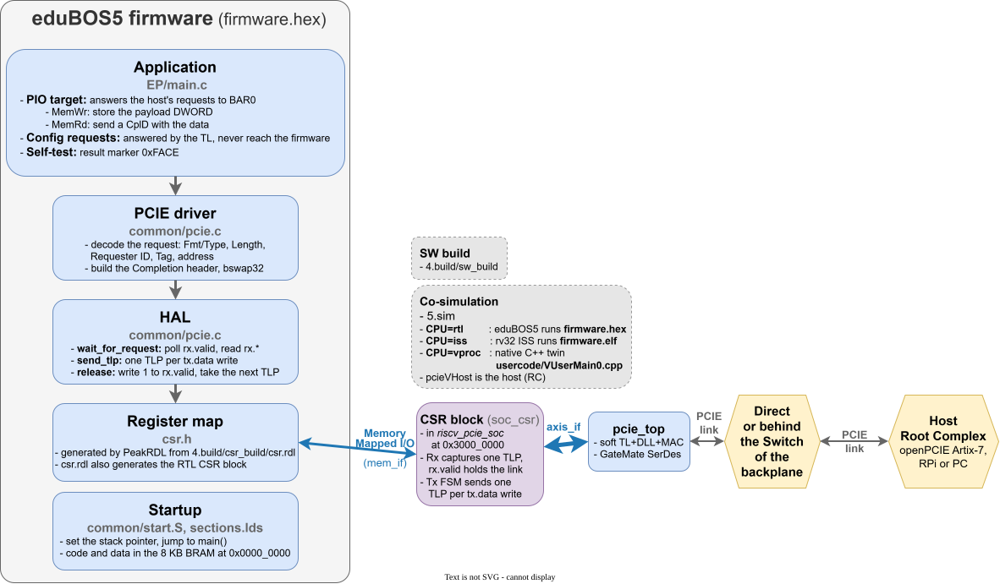

# SW Architecture

This is where the developers of **PIO TestApp** (the software part of) describe their work.

### HW/SW Architecture

We plan on creating not one, but three "Getting Started" examples, for the three representative compute platforms:
1) **Hard Embedded / Hosted**: RaspberryPi
2) **Soft Embedded / BareMetal**: Artix-7 FPGA acting as a RootComplex with soft on-chip RISC-V CPU
3) **General-purpose desktop/server class**: PC

## 1) RaspberryPi as RootPort

## 2) Artix-7 FPGA as RootPort

## 3) PC as RootPort

--------------------
#### End of Document
