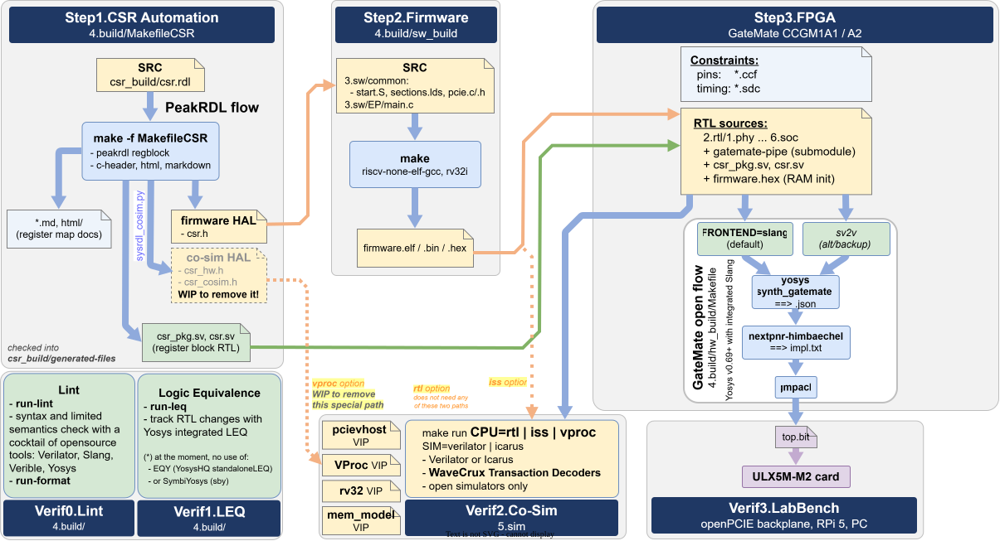

# _openCologne/PCIE_ Build Process

Describe how to use the new **nextpnr** based flow, constraints and timing closure methodology.

The flow is Yosys + nextpnr-himbaechel, the same as [openXC7](https://github.com/openXC7) on openPCIE: Yosys synthesizes (`read_slang` for SystemVerilog), nextpnr-himbaechel places and routes with the pins from a `.ccf` file and the timing from an `.sdc` file, and `gmpack` writes the bitstream.

The build is simpler than on openPCIE: one CPU core (eduBOS5) and one tool flow, with no Vivado option.

### Build Structure

#### References:
- [GateMate FPGA Toolchain Installation, UG1002](../0.doc/4.build/ug1002-GateMate-toolchain.May2026.pdf) by Cologne Chip, May 2026
- GateMate pin lists, from the DS1001 attachment, September 2026: [CCGM1A1](../0.doc/4.build/gatemate-ccgm1a1-pinlist.csv), [CCGM1A2](../0.doc/4.build/gatemate-ccgm1a2-pinlist.csv)
- nextpnr constraints: [general](https://github.com/YosysHQ/nextpnr/blob/master/docs/constraints.md), and the GateMate `.ccf` reader in nextpnr-himbaechel, [`ccf.cc`](https://github.com/YosysHQ/nextpnr/blob/master/himbaechel/uarch/gatemate/ccf.cc)
- [prjpeppercorn-test-cases](https://github.com/YosysHQ/prjpeppercorn-test-cases): open-flow GateMate test designs
- [Yosys](https://github.com/YosysHQ/yosys) with [slang](https://github.com/MikePopoloski/slang), and [nextpnr](https://github.com/YosysHQ/nextpnr) (himbaechel, GateMate): the tool flow; prebuilt in the [OSS CAD Suite](https://github.com/YosysHQ/oss-cad-suite-build/releases), as UG1002 recommends
- [PeakRDL](https://github.com/SystemRDL): `MakefileCSR`, CSR RTL, headers and docs from `csr_build/csr.rdl`
- [openFPGALoader](https://github.com/trabucayre/openFPGALoader): loads the bitstream over JTAG, GateMate included
- [fpgacapZero](https://github.com/lcapossio/fpgacapZero) (fcapz) -- open-source, vendor-agnostic FPGA debug cores: embedded logic analyzer, embedded I/O, JTAG-to-AXI and JTAG-to-UART bridges.

#### End of Document
