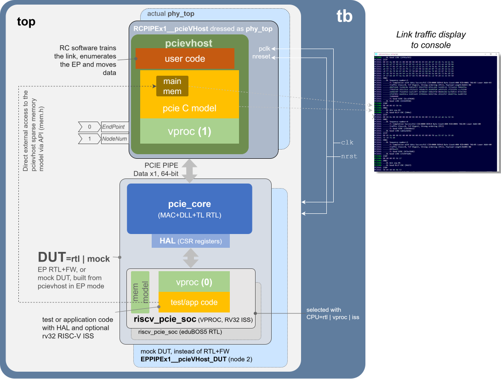

# openCologne-PCIE Simulation Top Level Test Bench

## Table of Contents

* [Block-level flows](#block-level-flows)
* [Running the co-simulation](#running-the-co-simulation)
  * [Verilator and Icarus, side by side](#verilator-and-icarus-side-by-side)
  * [From XSIM to open-source simulators: what it took](#from-xsim-to-open-source-simulators-what-it-took)
* [Introduction](#introduction)
* [Scope: MAC, DLL, TL and firmware](#scope-mac-dll-tl-and-firmware)
  * [A host already proven against real silicon](#a-host-already-proven-against-real-silicon)
* [VProc Software](#vproc-software)
  * [The CPU node: three ways to run the SOC's software](#the-cpu-node-three-ways-to-run-the-socs-software)
* [Debugging Code](#debugging-code)
* [The mem_model Co-Simulation Sparse Memory Model](#the-mem_model-co-simulation-sparse-memory-model)
* [Driving the PCIE Link](#driving-the-pcie-link)
* [Co-simulation HAL](#co-simulation-hal)
* [References](#references)


## Block-level flows

This directory is the top-level test bench. The layers below it have their own Icarus Verilog flows, next to their RTL: the PHY (PIPE + SerDes, and the opensource SerDes BFM) in [2.rtl/1.phy/3.sim](../2.rtl/1.phy/3.sim/), the DLL over that PHY in [2.rtl/4.dll/sim](../2.rtl/4.dll/sim/).

## Running the co-simulation

Open-source simulators only: Verilator (default) or Icarus Verilog. From `5.sim`, on Linux or WSL:

```sh
make run                 # Verilator
make SIM=icarus run      # Icarus Verilog
```

The first build fetches the VIP from upstream and builds it, once, into `~/.cache/opencologne-pcie-deps` ([`tools/fetch-vip.sh`](tools/fetch-vip.sh)): VProc, the pcieVHost PCIE model and mem_model, at the versions openPCIE uses. This repo keeps no copies of them, only our own wrappers in `models/`.

The DUT is selected with `DUT`: the EP RTL + firmware (`DUT=rtl`, once the TL exists), or the stand-in `EPPIPEx1__pcieVHost_DUT`, a second pcieVHost in EP mode ([`stubs`](stubs/README.md); `DUT=mock`, the default for now). The host is `RCPIPEx1__pcieVHost`, a pcieVHost in RC mode at node 1, running [`usercode/VUserMain1.cpp`](usercode/VUserMain1.cpp). A passing run shows the link train to L0 on both sides, then the host enumerate the EP: Vendor and Device ID, class code, all six BARs sized and assigned, the capability list walked, ending with `===> Finished with no errors`. The host program ends the simulation itself when it is done.

### Verilator and Icarus, side by side

The same test bench on both simulators (2026-10-18, WSL2, Verilator 5.052, Icarus Verilog 13.0, single runs; wall-clock times depend on host load):

| | Verilator | Icarus |
|---|---|---|
| Host results (`===>` lines) | 30, identical | 30, identical |
| LTSSM steps (`--->` lines) | 26 | 26 |
| Link display lines (TL, DL) | 838 | 830 |
| Simulated time at the end | 84 µs | 19.194 µs |
| Wall-clock time | 2.4 s | 20.9 s |
| Speed | 35 µs simulated per s | 0.92 µs simulated per s |
| C models reached via | DPI-C | VPI |
| Electrical idle on the line | `0` plus a side-band | `Z` on the wire |

Both reach the same result through the same link-training steps. Verilator, compiled to a native executable, is about 38 times faster per simulated microsecond. The two simulators end at different simulated times; why is not pinned down yet. The one modelling difference between them is electrical idle (below), so that is where to look first.

### From XSIM to open-source simulators: what it took

openPCIE runs its co-simulation on AMD's XSIM, because the encrypted Artix-7 hard macros left no other choice. Here all RTL is open, so the co-simulation moved to Verilator and Icarus. Each step on the way taught something about the models:

1. **Libraries built from source, per simulator.** XSIM loaded prebuilt `libcosimlnx.a` / `libpcielnx.a`. Verilator reaches the C models through DPI-C, Icarus through VPI, and the two need different builds of the same sources, so [`tools/fetch-vip.sh`](tools/fetch-vip.sh) builds both: `libcosimlnx.a` / `libpcielnx.a` for DPI-C, `libcosimica.a` / `libpcieica.a` for VPI. The VPI library also carries pcieVHost's `veriuser.c`, the table that registers the models' system tasks with Icarus.
2. **Every referenced module must exist.** The pcieVHost wrappers instantiate `clkmux` and `Serialiser` (from pcieVHost's `verilog/lib`), which the earlier XSIM file list never compiled. Verilator wants every module the design references, so the VIP build now collects them.
3. **Electrical idle: `Z` or a side-band.** A PCIE line that is electrically idle carries no signal, which a 4-state simulator (Icarus, XSIM) models as `Z`. Verilator is 2-state, it has no `Z`, so under Verilator `pcieVHostPipex1` drives idle as all zeros and adds two ports, `ElecIdleOut` and `ElecIdleIn`, for the models to tell each other. The test bench cross-connects them. Left open, the run still gives the same results, but it took 35.4 s instead of 2.4 s: the side-band is what keeps Verilator fast through link training. Icarus needs none of this; it has `Z`.
4. **openPCIE's LTSSM patch does not belong here.** On openPCIE the model plays the EP, an upstream port, against a real `PCIE_2_1` downstream port, and the patch makes it spec-correct: an upstream port keeps sending Link/Lane = PAD in its TS1 ordered sets until the downstream port assigns the numbers. Upstream's model takes a shortcut that only works against another copy of itself. Our stand-in pairs the patched EP model with the model's own RC side, which still expects that shortcut, and the link deadlocks in Configuration.Start, on both simulators. Here the model plays the RC, so there is nothing for the patch to fix: we use upstream's `ltssm.c` as is, and both sides reach L0.
5. **Macros before models.** The pcieVHost models use macros (`WsTimeScale`, `RegDel`, the comma symbols, the register map) defined in its headers. Under Verilator the first file in the list happened to pull them in for all others; Icarus has no such luck. [`tb.f`](tb.f) now names `allheaders.v` first, for both.
6. **Portable delays.** Icarus rejected the test bench's `#(N * 1ps)` delays. The file's timescale is 1 ps, so plain numbers mean the same and work everywhere; the run limit is a 64-bit constant, as 10 ms in picoseconds overflows 32 bits.

## Introduction

The top-level test bench drives the DUT's PCIE link with the [pcieVHost](https://github.com/wyvernSemi/pcievhost) VIP: a C model of a PCIE 1.1/2.0 link partner, connected to the logic simulation through the [VProc](https://github.com/wyvernSemi/vproc) virtual processor. VProc lets a program compiled natively on the host run "inside" an HDL component, in lock-step with the simulation; pcieVHost is such a program, wrapped so that its PCIE lanes appear as ports. It was designed as a root complex, the role it plays here, and has endpoint features too, enabled by a parameter; they are [limited](models/pcievhost/README.md#endpoint-feature-limitations) and meant as a target for testing the root complex side.

<p align=center>

</p>

The picture is forward-looking: it shows the final setup, with the EP RTL in place, to guide developers in building it. Parts of it do not exist yet: `top`, with the host in the `phy_top` socket, `pcie_core` (MAC + DLL + TL) and the `CPU=rtl | vproc | iss` switch. Today `tb.sv` connects the host straight to the mock EP (`DUT=mock`).

Each VProc instance is a node with its own program, `VUserMain<n>` for node `n`:

| Node | Model | Program | Role |
|---|---|---|---|
| 1 | `RCPIPEx1__pcieVHost` | [`usercode/VUserMain1.cpp`](usercode/VUserMain1.cpp) | the host: trains the link, enumerates the EP (IDs, BAR sizing and assignment, capabilities), then reads and writes BAR0 |
| 2 | `EPPIPEx1__pcieVHost_DUT` | [`usercode/VUserMain2.cpp`](usercode/VUserMain2.cpp) | the stand-in EP ([`stubs`](stubs/README.md)), an option next to the EP RTL + firmware: `DUT=mock` |
| 0 | `soc_cpu.VPROC` | native C/C++, or the rv32 ISS | the SOC's CPU, in place of eduBOS5, once the EP RTL is in (below) |

The model can print the traffic of both link directions to the console, layer by layer; [`hex/ContDisps.hex`](hex/ContDisps.hex) selects what is shown.

## Scope: MAC, DLL, TL and firmware

The top-level simulation is about the MAC/LTSSM, DLL and TL RTL and the firmware above them. It drives the DUT at its PIPE interface, so the PHY below it, Cologne Chip's PIPE logic and the GateMate SerDes, is not in this simulation at all. That is deliberate: each part is tested where it can be tested best.

| Level | Where | What it proves | Link partner |
|---|---|---|---|
| Top | `5.sim` (here) | MAC + DLL + TL RTL and the firmware: enumeration, configuration, PIO | `RCPIPEx1__pcieVHost`, at the PIPE |
| DLL over PIPE + PHY | [`2.rtl/4.dll/sim`](../2.rtl/4.dll/sim) | DLL, MAC/LTSSM, PIPE and SerDes BFM end to end on the serial line; drives TLPs until our TL is in | a second copy of the same stack |
| PIPE + PHY | [`2.rtl/1.phy/3.sim`](../2.rtl/1.phy/3.sim) | Cologne Chip's PIPE logic over the GateMate SerDes; the opensource [SerDes BFM](../2.rtl/1.phy/2.serdes-model) against the vendor model | the vendor's PIPE test case; the BFM, looped back |

All of them, with how to run each and today's status: [Simulation, layer by layer](../2.rtl/README.md#simulation-layer-by-layer).

The SerDes BFM ([`2.rtl/1.phy/2.serdes-model`](../2.rtl/1.phy/2.serdes-model)) is what makes the PHY testable at all in open source: the vendor's SerDes model is under NDA, the opensource BFM is not, and it is checked against the vendor model ([equivalence checking](../2.rtl/1.phy/2.serdes-model/0.doc/equivalence-checking.md)).

Why split it this way:

- **Speed.** Below the PIPE, the SerDes runs at the serial bit rate, 2.5 Gb/s; the top level would spend most of its time on bits that tell nothing about a TLP. At the PIPE, eight symbols move per 31.25 MHz clock, and a full enumeration runs in seconds.
- **One question per test bench.** When the top level fails, the fault is in the MAC, the DLL, the TL or the firmware, because the PHY has already been proven on its own. A failing link never has to be untangled across all layers at once.
- **No NDA in the main flow.** The vendor SerDes model never has to be present for the top level, so anyone can run it.
- **Each layer validated against an independent partner.** The PIPE against the vendor's PIPE test case, the SerDes BFM against the vendor model, the DLL over the PHY against a second instance of the stack, and MAC, DLL and TL against pcieVHost here.

### A host already proven against real silicon

`RCPIPEx1__pcieVHost` is the pcieVHost model in a thin wrapper of ours ([`models/RCPIPEx1__pcieVHost.sv`](models/RCPIPEx1__pcieVHost.sv)) around upstream's `pcieVHostPipex1`, fixed to the RC role. The same model and PIPE wrapper were validated on [openPCIE](https://github.com/chili-chips-ba/openPCIE/tree/main/5.sim) against the AMD `PCIE_2_1` hard macro: link training, flow control, TLPs and completions, end to end. There the roles were the other way round, the model the EP and the hard macro the RC. What that run established is that the model and the AMD hard macro speak the same PCIE. An EP that passes against this model in simulation therefore stands a better chance of working on the first try in hardware, when a physical Artix-7, running openPCIE as the RC, drives our GateMate EP over the [openPCIE backplane](https://github.com/chili-chips-ba/openPCIE/tree/main/1.pcb).

## VProc Software

A VProc program is ordinary C or C++ with one difference: its entry point is `VUserMain<n>()`, with C linkage, instead of `main()`, because the simulator already has a `main()` and each node has its own program. Under it, VProc's scheduler talks to the simulator over DPI-C (Verilator) or VPI (Icarus); the program does not see the difference. VProc offers a low-level C API and a C++ one, the `VProc` class in `VProcClass.h` (its headers are in `$VIP_DIR/include`, see [Running the co-simulation](#running-the-co-simulation)):

```c++
VProc (const uint32_t node);

int  write (const unsigned addr, const unsigned  data, const int delta=0);
int  read  (const unsigned addr,       unsigned *data, const int delta=0);
int  tick  (const unsigned ticks);
```

Addresses are byte addresses; `delta` stays at its default. `tick()` advances simulation time by a number of clock cycles of the clock the node is connected to, without a bus transaction. Finer accesses exist too, `writeByte`, `writeHword`, `writeWord` and their `read` twins; the [VProc manual](https://github.com/wyvernSemi/vproc/blob/master/doc/VProc.pdf) has the rest.

A program can also reach the sparse memory model directly, through `mem.h` (C functions, so `extern "C"` from C++):

```c++
void     WriteRamByte  (const uint64_t addr, const uint32_t data, const uint32_t node);
void     WriteRamHWord (const uint64_t addr, const uint32_t data, const int little_endian, const uint32_t node);
void     WriteRamWord  (const uint64_t addr, const uint32_t data, const int little_endian, const uint32_t node);
uint32_t ReadRamByte   (const uint64_t addr, const uint32_t node);
uint32_t ReadRamHWord  (const uint64_t addr, const int little_endian, const uint32_t node);
uint32_t ReadRamWord   (const uint64_t addr, const int little_endian, const uint32_t node);
```

Being C, they have no default arguments. `node` here selects a memory space, not a VProc node; we use one, 0. Every `mem_model` instance in the HDL sees the same memory as this API, so programs and logic can exchange data through it.

<p align="center">

</p>

### The CPU node: three ways to run the SOC's software

Once the EP RTL is in, node 0 can stand in for eduBOS5 in the SOC's CPU socket ([`models/soc_cpu.VPROC.sv`](models/soc_cpu.VPROC.sv), on the same `mem_if` bus), in the same three ways as on openPCIE:

- **RTL:** eduBOS5 itself runs `firmware.hex`, as in the bitstream. The reference.
- **Native:** a C/C++ program compiled for the host drives the bus. With the co-simulation HAL ([below](#co-simulation-hal)) the firmware's own sources compile this way, and run much faster than on the RTL core.
- **ISS:** the [rv32](https://github.com/wyvernSemi/rv32) instruction set simulator runs the real RISC-V `firmware.elf`: real instructions, interpreted rather than executed by RTL. Its integration program ([`models/rv32/usercode`](models/rv32/usercode)) routes each load and store to the memory model, to a bus transaction on the SOC, or back to the ISS. The ISS sources are fetched from upstream with openPCIE's fixes, not kept here: `bash tools/fetch-rv32.sh`.

The ISS reads its options from `vusermain.cfg`, in the form of a command line for `vusermain0`. A set of timing models makes it count cycles like a given core; `-V EDUBOS5STG2` (2-stage eduBOS5) or `-V EDUBOS5STG3` match ours.

One of the options is <tt>-h</tt> for a help message, which is as shown below:
```
Usage:vusermain0 -t <test executable> [-hHebdrgxXRcI][-n <num instructions>]
      [-S <start addr>][-A <brk addr>][-D <debug o/p filename>][-p <port num>]
      [-l <line bytes>][-w <ways>][-s <sets>][-j <imem base addr>][-J <imem top addr>]
      [-P <cycles>][-x <base addr>][-X <top addr>][-V <core>]
   -t specify test executable/binary file (default test.exe)
   -B specify to load a raw binary file (default load ELF executable)
   -L specify address to load binary, if -B specified (default 0x00000000)
   -n specify number of instructions to run (default 0, i.e. run until unimp)
   -d Enable disassemble mode (default off)
   -r Enable run-time disassemble mode (default off. Overridden by -d)
   -C Use cycle count for internal mtime timer (default real-time)
   -a display ABI register names when disassembling (default x names)
   -T Use external memory mapped timer model (default internal)
   -H Halt on unimplemented instructions (default trap)
   -e Halt on ecall instruction (default trap)
   -E Halt on ebreak instruction (default trap)
   -b Halt at a specific address (default off)
   -A Specify halt address if -b active (default 0x00000040)
   -D Specify file for debug output (default stdout)
   -R Dump x0 to x31 on exit (default no dump)
   -c Dump CSR registers on exit (default no dump)
   -g Enable remote gdb mode (default disabled)
   -p Specify remote GDB port number (default 49152)
   -S Specify start address (default 0)
   -I Enable instruction cache timing model (default disabled)
   -l Specify number of bytes in icache line (default 8)
   -w Specify number of ways in icache (default 2)
   -s Specify number of sets in icache (default 256)
   -j Specify cached IMEM base address (default 0x00000000)
   -J Specify cached IMEM top address (default 0x7fffffff)
   -P Specify penalty, in cycles, of one slow mem access (default 4)
   -x Specify base address of external access region (default 0xFFFFFFFF)
   -X Specify top address of external access region (default 0xFFFFFFFF)
   -V Specify RISC-V core timing model to use (default "DEFAULT")
   -h display this help message
```

## Debugging Code

The simulation is a native process, and the user programs are part of it, so the host `gdb` debugs them directly; build them with `-g` (the default `OPTFLAG`):

```sh
gdb --args obj/verilator/Vtb                                          # Verilator
gdb --args vvp -n -M obj/icarus -m VProc obj/icarus/sim               # Icarus
(gdb) break VUserMain1
(gdb) run
```

There is no simulator kernel to attach to, as there was with XSIM: the breakpoint stops the whole simulation, and inspecting the C++ state of the host program, a TLP it built or the BAR values it read, works as in any program.

Code running on the rv32 ISS is debugged with the RISC-V `gdb` instead: with `-g` in `vusermain.cfg`, the ISS opens a TCP port and prints its number (e.g. `RV32GDB: Using TCP port number: 49152`), and `(gdb) target remote :49152` connects to it. The [ISS manual](https://github.com/wyvernSemi/rv32/blob/main/iss/doc/iss_manual.pdf) has the details.

## The mem_model Co-Simulation Sparse Memory Model

[mem_model](https://github.com/wyvernSemi/mem_model) is a sparse memory, written in C as part of the pcieVHost software: it maps a 64-bit address space and allocates pages only when they are touched. Programs reach it through the API above; logic reaches the same memory through the `mem_model` HDL component, which may be instantiated any number of times. That shared space is how a VProc program and the simulated logic hand data to each other. Details: [`models/cosim/README.md`](models/cosim/README.md).

## Driving the PCIE Link

The EP has a single x1 PIPE port, 64 bits wide, as Cologne Chip's PIPE. `pcieVHostPipex1`, the PIPE wrapper of the pcieVHost model, drives it with Gen1 traffic:

<p align=center>

</p>

On a 64-bit PIPE, eight symbols travel per PIPE clock, so `pclk` runs at `pcieclk`/8: 31.25 MHz against the 250 MHz symbol clock of Gen1. Configuring and driving the model: [`models/pcievhost/README.md`](models/pcievhost/README.md).

## Co-simulation HAL

`make -f MakefileCSR` in `4.build` generates, from the single register map `csr_build/csr.rdl`, the CSR RTL, the C header the firmware uses (`csr.h`), and two C++ HALs: `csr_hw.h` for the hardware and `csr_cosim.h` for co-simulation ([`sysrdl_cosim.py`](../4.build/sysrdl_cosim.py)). Both present the same API, a hierarchy of register objects that mirrors the RDL, so the same application source compiles for the RISC-V target and for a native VProc program on node 0; only the header behind it changes, and with it whether an access is a pointer dereference or a VProc bus transaction.

Two more things differ between the two builds, and the generated headers cover both:

- **The entry point.** The hardware build starts at `main()`, the co-simulation at `VUserMain0()`. The headers define `PCIEMAIN` as one or the other, so the application writes `void PCIEMAIN (void)`.
- **Delays.** A delay loop on the target is wasted simulation time in co-simulation. Wrap delays in one function whose co-simulation version converts time into clock cycles and calls VProc's tick. `csr_cosim.h` defines `SOC_CPU_CLK_PERIOD_PS` for that (16000 ps unless defined before the include) and `SOC_CPU_VPNODE`, the CPU node (0; option `-v` of `sysrdl_cosim.py`).

## References:
- [Logic sim using pcieVHost and 3rd Party PCIe](https://www.linkedin.com/pulse/case-study-logic-simulation-environment-using-third-party-southwell-tyere)
- [VProc](https://github.com/wyvernSemi/vproc)
- [mem_model](https://github.com/wyvernSemi/mem_model)
- [PCIe VHost Model](https://github.com/wyvernSemi/pcievhost)
- [rv32 RISC-V ISS](https://github.com/wyvernSemi/rv32/tree/main/iss)
- [SystemRDL](https://www.accellera.org/downloads/standards/systemrdl)
- [PeakRDL and SystemRDLcompiler](https://github.com/SystemRDL)
