# openCologne-PCIE Simulation Top Level Test Bench

## Table of Contents

* [Block-level flows](#block-level-flows)
* [Running the co-simulation](#running-the-co-simulation)
  * [Modeling options: DUT, PHY, CPU](#modeling-options-dut-phy-cpu)
  * [WaveCrux decoders](#wavecrux-decoders)
  * [Transaction taps: a test platform at every layer](#transaction-taps-a-test-platform-at-every-layer)
  * [Viewing the EP in WaveCrux](#viewing-the-ep-in-wavecrux)
  * [Choosing the user code](#choosing-the-user-code)
  * [Verilator and Icarus, side by side](#verilator-and-icarus-side-by-side)
  * [Build defines](#build-defines)
  * [From XSIM to Verilator, via Icarus](#from-xsim-to-verilator-via-icarus)
  * [VIP versions and local changes](#vip-versions-and-local-changes)
* [Introduction](#introduction)
* [Scope: unit debug, then top-level validation](#scope-unit-debug-then-top-level-validation)
  * [A host already proven against real silicon](#a-host-already-proven-against-real-silicon)
* [VProc Software](#vproc-software)
  * [The CPU node: three ways to run the SOC's software](#the-cpu-node-three-ways-to-run-the-socs-software)
* [Debugging Code](#debugging-code)
* [The mem_model Co-Simulation Sparse Memory Model](#the-mem_model-co-simulation-sparse-memory-model)
* [Driving the PCIE Link](#driving-the-pcie-link)
* [Co-simulation HAL](#co-simulation-hal)
* [References](#references)


## Block-level flows

This directory is the top-level test bench. The layers below it have their own Icarus Verilog flows, next to their RTL: the PHY (PIPE + SerDes, and the opensource SerDes BFM) in [2.rtl/1.phy/3.sim](../2.rtl/1.phy/3.sim/), the DLL over that PHY in [2.rtl/4.dll/sim](../2.rtl/4.dll/sim/).

## Running the co-simulation

Open-source simulators only: Verilator (default) or Icarus Verilog. From `5.sim`, on Linux or WSL:

```sh
make run                 # Verilator
make SIM=icarus run      # Icarus Verilog
make DUMP=1 run          # also write tb.fst
make DUT=rtl run         # our EP RTL + firmware, the host at the PIPE
make DUT=rtl PHY=rtl run # the same with the real PHY, the host on the serial line
make DUT=rtl DUMP=1 run  # also write tb_rtl.fst: every layer of the EP, for WaveCrux
```

`DUMP=1` writes the FST natively (Verilator `--trace-fst`, Icarus `vvp -fst`): the PIPE link both ways, its clock and reset, and the decoder pages of both pcieVHosts (`tb.u_rc`, `tb.dut.bfm_pcie`): every decoder input on one page per side (PIPE, DLL, TLPs), under the names WaveCrux auto-binds. With `DUT=rtl` it writes `tb_rtl.fst` (`PHY=rtl`: `tb_rtl_phy.fst`) instead, with a decoder page at every layer boundary of our EP ([below](#viewing-the-ep-in-wavecrux)). Verilator 5.052 writes FST with its own writer, which needs the lz4 headers (`liblz4-dev`). [`tb.DLL-PIPE.wavecrux`](tb.DLL-PIPE.wavecrux) opens the tracked [`tb.fst`](tb.fst) (Verilator run) in WaveCrux with Ferrite's PIPE and DLL decoders on both directions. It binds signals by their number in the file, so after a change to the dumped signals, run [`tools/wavecrux-rebind.py`](tools/wavecrux-rebind.py) on it.

The VIP (VProc, the pcieVHost PCIE model, mem_model) is copied from upstream into [`vip`](vip/README.md). The first build compiles it once into `~/.cache/opencologne-pcie/vip` ([`tools/build-vip.sh`](tools/build-vip.sh)). Our own wrappers are in `models/`.

The DUT is selected with `DUT`: the EP RTL + firmware (`DUT=rtl`: [`rtl.f`](rtl.f), with the host in the `phy_top` socket through [`models/phy_vproc_rc.sv`](models/phy_vproc_rc.sv)), or the mock `EPPIPEx1__pcieVHost_DUT`, a second pcieVHost in EP mode ([`stubs`](stubs/README.md); `DUT=mock`, the default for now). The host is `RCPIPEx1__pcieVHost`, a pcieVHost in RC mode at node 1, running [`usercode/VUserMain1.cpp`](usercode/VUserMain1.cpp). A passing run shows the link train to L0 on both sides, then the host enumerate the EP: Vendor and Device ID, class code, all six BARs sized and assigned, the capability list walked, ending with `===> Finished with no errors`. The host program ends the simulation itself when it is done.

With `DUT=rtl` the host program is [`usercode/VUserMain1_rtl.cpp`](usercode/VUserMain1_rtl.cpp): the same enumeration for our one BAR0 (4 KB), Memory Space and Bus Master enabled, then DWORD writes and reads in BAR0 that the firmware serves, all checked, with scrambling on. Today the run stops in flow-control initialisation, on gatemate-pipe's DLL:

- it repeats InitFC1/InitFC2 only every 34 µs, and pcieVHost leaves its own FC init only after one more complete set of InitFC DLLPs, so the host never sends a TLP;
- its InitFC credits are fixed ([#22](https://github.com/chili-chips-ba/openCologne-PCIE/issues/22)): the first UpdateFC of our TL then looks to the host like a jump of 233 header credits, and the host stops;
- a TLP that arrives right after another one is dropped without a Nak.

With these three worked around locally, the run ends with `===> Finished with no errors` and `fw_pass` set, with `PHY=rtl` too.

With `PHY=rtl`, `tb.sv` puts `top` under the host: `phy_top` with Cologne Chip's PIPE logic and the opensource SerDes BFM ([`phy.f`](phy.f)), on a 2.5 Gb/s serial line. The host is then upstream's `PcieVhostSerial`, at node 1 with the same host program, without the transaction taps of our PIPE wrapper. It runs with `Gen2Clk = 1` and twice the Gen1 clocks (500 MHz, 5 GHz), which it divides by 2 at Gen1: with `Gen2Clk = 0` its `generate` block drives the bit clock twice, once straight and once halved (the `else` has no `begin`/`end`), and under Verilator the line ran at 1.25 Gb/s.

### Modeling options: DUT, PHY, CPU

Three `make` switches choose the models, as in the [block diagram](#introduction):

| Switch | Values | Selects | Today |
|---|---|---|---|
| `DUT` | `mock` (default), `rtl` | the EP: a second pcieVHost in EP mode (`EPPIPEx1__pcieVHost_DUT`, node 2), or our MAC + DLL + TL RTL with firmware | both; `rtl` stops in FC init, [above](#running-the-co-simulation) |
| `PHY` | `vproc_rc`, `rtl` | the `phy_top` socket: the host `RCPIPEx1__pcieVHost` (node 1), or the real PHY | both, with `DUT=rtl`; `rtl`: the host is `PcieVhostSerial`, [above](#running-the-co-simulation) |
| `CPU` | `rtl`, `vproc`, `iss` | the SOC CPU, with `DUT=rtl`: eduBOS5 RTL, a native C/C++ program at node 0, or the rv32 ISS ([below](#the-cpu-node-three-ways-to-run-the-socs-software)) | not a switch yet; needs `DUT=rtl` |

`SIM` (`verilator`, `icarus`) and `DUMP` (`0`, `1`) choose the simulator and the waveform, not the models.

### WaveCrux decoders

Three sets of decoders, one per layer, that complement each other:

| Decoders | Show | Where |
|---|---|---|
| Ferrite's PIPE, Data Link Layer and serial-line decoders (free) | ordered sets, DLLPs, Ack/Nak, flow control, LCRC, TLP framing | [wavecrux-decoders `decoders/pcie`](https://github.com/Ferrite-Engineering/wavecrux-decoders/tree/main/decoders/pcie) |
| Our TLP decoder (free) | every TLP named, each completion paired with its request | [`tools/wavecrux-pcie-tlp`](tools/wavecrux-pcie-tlp), moving to wavecrux-decoders ([PR #13](https://github.com/Ferrite-Engineering/wavecrux-decoders/pull/13)) |
| WaveCrux Pro PCIe TLP analysis | latency, timeouts, Base Spec rule checks, bus statistics | [WaveCrux docs](https://github.com/Ferrite-Engineering/wavecrux/blob/main/docs-site/docs/protocol-decoders.md#pcie-tlp-analysis) |

Here today: Ferrite's DLL decoder names each TLP from the PIPE bits (`TLP seq=5 MWr32 len=1`). Our TLP decoder reads the host's TLP stream from `tb.u_rc` (prefix `tx_` for RC -> EP, `rx_` for EP -> RC): transaction taps we added to pcieVHost ([details](models/pcievhost/README.md#transaction-taps-our-change)). With `DUT=rtl`, all three sets decode our EP's own layers, from the PIPE to the firmware ([Viewing the EP in WaveCrux](#viewing-the-ep-in-wavecrux)).

### Transaction taps: a test platform at every layer

Each pcieVHost reports every TLP and DLLP it sends and receives on ports of its own: [transaction taps](models/pcievhost/README.md#transaction-taps-our-change) we added to the model. Our wrapper [`PIPEx1__pcieVHost`](models/PIPEx1__pcieVHost.sv) offers each packet at three layers, from one run, all always present. Both sides use it: the host `RCPIPEx1__pcieVHost` (`EndPoint=0`) and the mock EP `EPPIPEx1__pcieVHost_DUT` (`EndPoint=1`). Each side has its decoder page, with the same names, by link direction (dn = RC -> EP, up = EP -> RC): `tb.u_rc` and `tb.dut.bfm_pcie`. A packet shows on both, a link latency apart.

<p align="center">
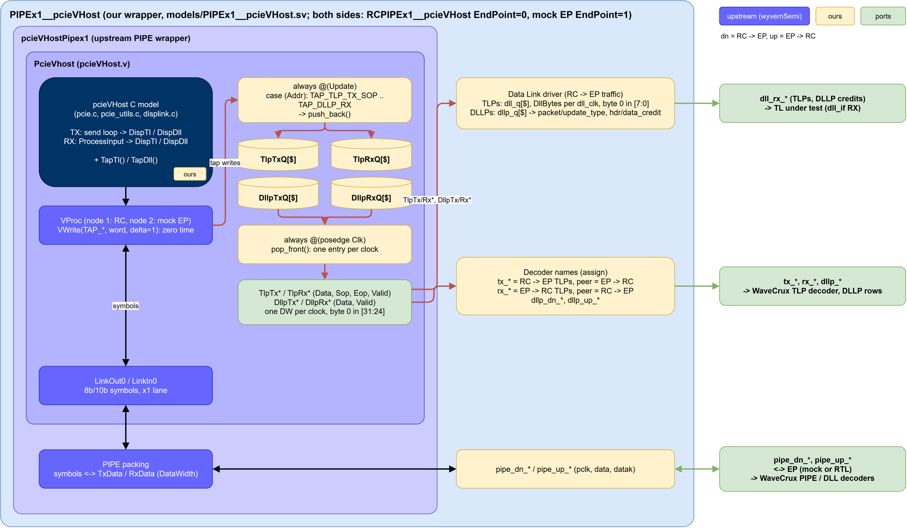
</p>

| Layer | Ports of `tb.u_rc`, `tb.dut.bfm_pcie` | For |
|---|---|---|
| PIPE | `pipe_dn_*`, `pipe_up_*` (`pclk`, `data`, `datak`) | the link; PIPE and DLL decoders |
| Data Link | `dll_rx_*`, on `dll_clk`: TLPs (`data`, `tlp_valid`, `tlp_first`, `tlp_last`) and DLLPs (`hdr_credit`, `data_credit`, `update_type`, `packet_type`, `dllp_valid`) | RC -> EP traffic as an EP's DLL hands it to its TL (`dll_if` RX side): drives a TL under test |
| Data Link | `dllp_dn_*`, `dllp_up_*` | every DLLP, one word each |
| Transaction | `tx_*` (RC -> EP), `rx_*` (EP -> RC) | the TLP decoder |

The `dll_rx_*` fields follow Cologne Chip's DLL ([DLL draft v2](../2.rtl/0.doc/260711-DLL_draft_v2.pdf), slides 7 and 9): TLP byte 0 in `data[7:0]`, the first byte on the wire; DLLP Type = {`packet_type`, `update_type`, 0, VC}, so `packet_type` 01 InitFC1, 11 InitFC2, 10 UpdateFC, and `update_type` 00 P, 01 NP, 10 Cpl. Like that DLL, every DLLP raises `dllp_valid`.

What it gives us:

- **RTL driven from the model.** `dll_rx_*` has the shape of `dll_if`'s RX side, so a TL can be tested without the MAC and DLL below it, on its own clock.
- **A reference for the DUT.** What the host sent and received, packet by packet, to compare against the DUT's own TL and DLL interfaces once `DUT=rtl` is in.
- **Self-checking tests.** A checker reads the taps, not the console log.
- **Decoder fixtures from an open simulator.** Verilator and Icarus give the same TLPs at the same times (50 each way in the enumeration run), with expected values from the model, not from a decoder.
- **Any link partner.** The host's taps work with the mock EP and the EP RTL alike; with the mock EP, both ends of the link are tapped.

### Viewing the EP in WaveCrux

With `DUT=rtl`, `DUMP=1` gives our EP a decoder page at every layer boundary: [`models/ep_wavecrux_view.sv`](models/ep_wavecrux_view.sv), bound into `pcie_core` as `wavecrux` (`tb.dut.u_core.wavecrux`, with `PHY=rtl` `tb.dut.u_pcie_top.u_core.wavecrux`), and the CPU's retired instructions, `riscv_pcie_soc.cpu_view` (`DUMP=1` builds eduBOS5 with `RISCV_FORMAL`). [`wavecrux.f`](wavecrux.f) lists the view files. Verilator does not limit the trace to the `$dumpvars` scopes, so the FST also holds all of `pcie_top`, six levels deep: the RTL behind every decoded packet is in the same file.

| Boundary | Names | Decoder | Sessions |
|---|---|---|---|
| PIPE, PHY ↔ MAC | `pipe_dn_*`, `pipe_up_*` | wcx-pcie: PCIe PIPE and PCIe Data Link Layer, 64-bit, `scrambling` auto | layers, free |
| MAC ↔ DLL | `mac_dn_*`, `mac_up_*` | wcx-pcie: PCIe Data Link Layer, `scrambling` off | layers, free |
| DLL ↔ TL, `dll_if` | `dll_*` | WaveCrux Pro: PCIe TLP, generic, Data Width 64 | layers, serial |
| TL ↔ `trn_bridge`, `trn_if` | `trn_*` | the same | layers, serial |
| `trn_bridge` ↔ SOC, AXI-Stream | `m_axis_rx_*`, `s_axis_tx_*` | WaveCrux Pro: PCIe TLP, Xilinx 7 Series AXIS preset | layers, serial |
| | `tlp_view.tx_*`, `tlp_view.rx_*` | our [TLP decoder](tools/wavecrux-pcie-tlp) (free), one DW per clock | free |
| SOC CPU | `tb.dut.u_soc.cpu_view.rvfi_*` | WaveCrux: RISC-V instruction trace | all |
| serial line, `PHY=rtl` | `tb.ser_dn_line`, `tb.ser_up_line` | wcx-pcie: PCIe serial line, symbols and Data Link Layer | serial |
| host taps, `PHY=vproc_rc` | `tb.u_rc` `tx_*`, `rx_*` | our TLP decoder | layers, free |

As on the host's page, dn is RC -> EP and up is EP -> RC. The Pro TLP decoder takes both directions in one instance, `tlp_*` RC -> EP and `peer_*` EP -> RC, and pairs every completion with its request. Its Data Width has to be 64: at its default, 32, it reads only the lower DW of each beat, and the completions come out wrong.

The sessions open the FST from this directory: [`tb_rtl.EP-layers.wavecrux`](tb_rtl.EP-layers.wavecrux) (all boundaries, Pro), [`tb_rtl.EP-free.wavecrux`](tb_rtl.EP-free.wavecrux) (the free decoders only) and, for `PHY=rtl`, [`tb_rtl_phy.EP-serial.wavecrux`](tb_rtl_phy.EP-serial.wavecrux). They need WaveCrux 1.1.0, with the [wcx-pcie](https://github.com/Ferrite-Engineering/wavecrux-decoders/releases/tag/pcie-v0.2.0) 0.2.0 and the [`tools/wavecrux-pcie-tlp`](tools/wavecrux-pcie-tlp) plugins added under **Settings -> Extensions -> Decoder Plugins**, the plugin notice accepted (until then the decoder rows stay empty, without a message), and a Pro licence for the Pro rows. A session binds its decoders by signal number, the FST handle, and a change to the RTL can renumber them: then run [`tools/wavecrux-rebind.py`](tools/wavecrux-rebind.py).

The pictures are WaveCrux Pro 1.1.0 with wcx-pcie 0.2.0. The column on the far left, with the layer of every row, is not WaveCrux's: we added it to the screenshots, because WaveCrux names a decoder row only by its decoder (`PCIe TLP #1`, in its own name column next to ours). Link training, flow-control init and the MAC findings are from the repo as it is. The rest are from a run with the three DLL issues [above](#running-the-co-simulation) worked around locally, as without them no TLP gets through: InitFC repeated every 0.1 µs ([#25](https://github.com/chili-chips-ba/openCologne-PCIE/issues/25)), the TL given the DLL's fixed InitFC credits ([#22](https://github.com/chili-chips-ba/openCologne-PCIE/issues/22)) and a gap after every write of the host ([#26](https://github.com/chili-chips-ba/openCologne-PCIE/issues/26)). Where a picture shows a stretch too long for the decoders' labels, a zoomed one follows it.

**The whole run.** Host on top, then the request path down to the CPU, then the answer path back up:

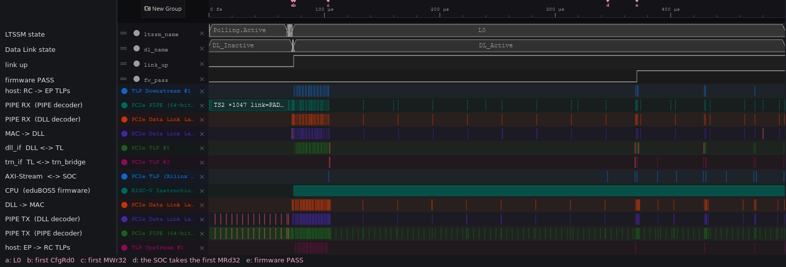

- 0 to 72 µs, link training. Most of it is Polling.Active: the EP sends the 1024 TS1 the specification asks for (65.5 µs), while the host, with its abbreviated LTSSM, already waits in Polling.Configuration sending TS2 (`TS2 ×1047`). L0 at 72.2 µs (a), DL_Active at 73.4 µs.
- 74 to 103 µs, enumeration (b): 22 configuration requests. `dll_if` is busy, `trn_if` and the AXI-Stream stay quiet: the TL answers them itself.
- 103 µs, the first MWr32 and MRd32 to BAR0 (c) go on to the SOC. The SOC takes the MRd32 only at 345 µs (d): until then eduBOS5 clears its PIO memory (`pio_mem` in [`main.c`](../3.sw/EP/main.c), 256 words, 11 instructions each: the firmware is built without `-O`). The CPU row is full from the moment it leaves reset, with the link.
- 345 to 499 µs, PIO, one request at a time, 24 µs each, almost all of it in the firmware; `fw_pass` at 370.7 µs (e).

Zoomed in on the CPU row, the loop that clears `pio_mem`. On top, a later turn of it (80 to 82 µs): the PC runs through `0x58c` to `0x5b4` again and again. Below, the RISC-V decoder's table with its first turn, from 74.29 µs: 11 instructions per word, and the loop counter read from the stack and written back on every turn (`lw a4, -20(s0)`, `sw a5, -20(s0)`), as a build without `-O` makes it. One word takes 1 µs, the 256 of them about 250 µs:

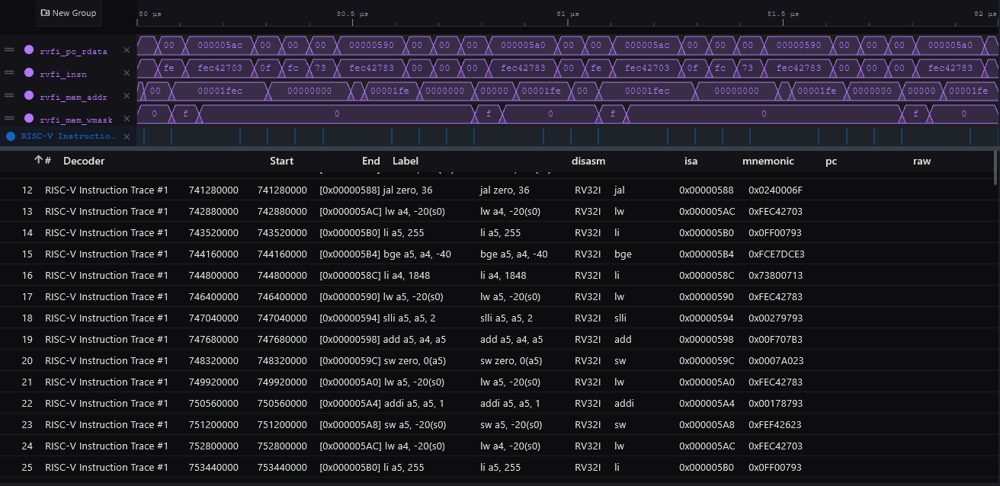

**Link training and flow-control init** (repo as it is). The PIPE decoder names every training sequence with its fields: the host's `TS2 link=PAD lane=PAD n_fts=4`, the EP's `TS1 link=PAD lane=PAD n_fts=0`, then `TS1 link=0 lane=PAD` (Config.Linkwidth), `TS1 link=0 lane=0` (Config.Lanenum), `TS2 link=0 lane=0` (Config.Complete) and L0, where the DLLPs start:

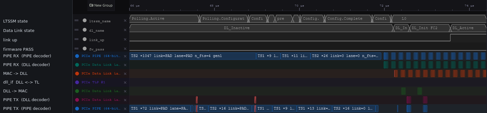

Zoomed in on 68.85 to 70.45 µs, through Configuration: the host's `TS1 link=0 lane=PAD` and `TS1 link=0 lane=0`, the EP's `TS1 link=PAD lane=PAD n_fts=0`, then `link=0 lane=PAD` and `link=0 lane=0`, under the LTSSM states of the EP; the red box on the EP's side is the cut TS2 of *Found with the decoders*, below:

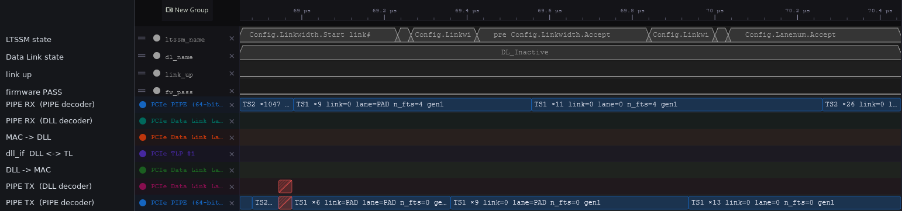

The flow-control init is [#25](https://github.com/chili-chips-ba/openCologne-PCIE/issues/25) as it happens: the EP sends one InitFC1 set when it enters DL_Init FC1, one InitFC2 set in FC2, and goes to DL_Active at 73.55 µs on the host's InitFC2. The host keeps repeating its InitFC2 set, every 0.18 µs, waiting for one more set of the EP, which never comes; for the rest of the run the EP sends only an UpdateFC every 30 µs, and no TLP crosses `dll_if`:

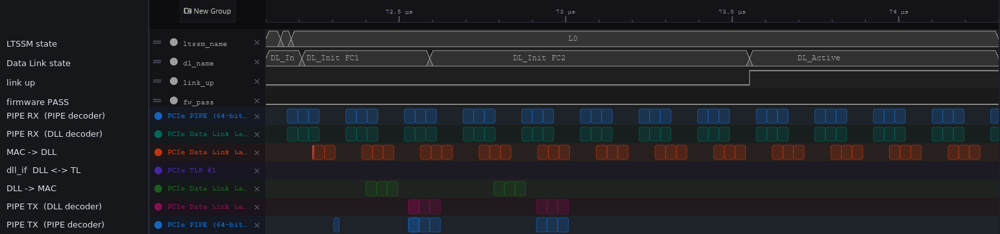

Zoomed in on the two sets of the EP, with the fixed credits of [#22](https://github.com/chili-chips-ba/openCologne-PCIE/issues/22) (H=32 for P and NP, Cpl infinite): `InitFC1-P`, `-NP`, `-Cpl` in DL_Init FC1 (top), `InitFC2-*` in FC2 (bottom), on DLL -> MAC and on the PIPE. The host is still sending InitFC1 then. On the PIPE TX row of the top half, the decoder's `Scrambling: on (detected)` notice is drawn over the first DLLP ([wavecrux#52](https://github.com/Ferrite-Engineering/wavecrux/issues/52)):

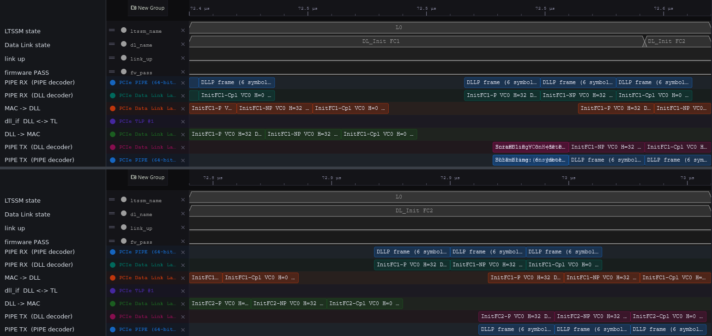

**Found with the decoders.** The red rows are the decoders' error flags. Two point at our MAC, on its transmit and on its receive side, and the first of them shows a gap in the decoder too.

Every SKP the EP sends in Polling cuts a TS1 short: its first 8 symbols, 16 data symbols (`f527f4ec622438c8`, `e2d32ce6a740be8d`), the SKP ordered set with 4 data symbols behind it (`14c017ff1c1c1cbc`, K `0f`), 8 zero symbols, then the next TS1. The same every 4.77 µs, 14 times before L0:

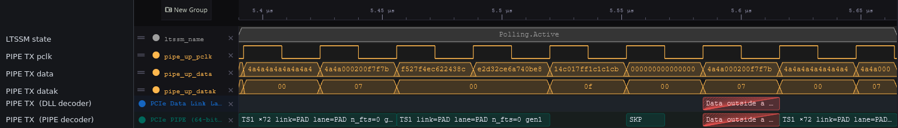

Once more with a TS2, on the step from Polling.Configuration to Config.Linkwidth.Start (68.88 µs): its first half (`4545000200f7f7bc`), then data (`fa28fbe36d2b37c7`) and 8 zero symbols instead of its second half, then TS1. Only ordered sets may be sent in Polling and Configuration. pcieVHost does not mind; a link partner that counts consecutive TS1 or TS2 may:

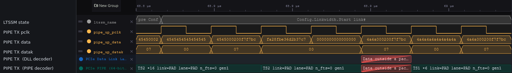

The MAC's receive side drops the COM of every SKP ordered set the host sends, but passes its three SKP symbols to the DLL as data: MAC -> DLL carries `f00308c05c1c1c1c` with K `08`, so `1c 1c 1c` as data before the SDP of the next DLLP, and the decoder flags `Data outside a packet`. It happens every 80 µs, the host's SKP interval; the DLL ignores them:

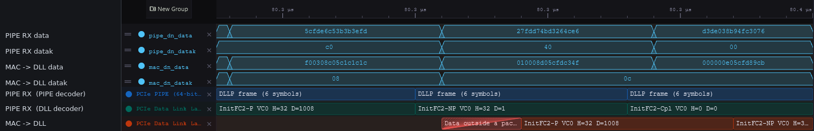

The gap in the decoder: it shows the cut TS1 above as a whole one, the 16 data symbols as its tail, with no error, as it does not check the TS1 identifiers in symbols 8 to 15 (the same for the TS2). Only the data after the SKP is flagged.

**A configuration read, layer by layer.** The host's first request, CfgRd0 of the Vendor and Device ID. The TL answers it from its configuration space, so it goes no further than `dll_if`:

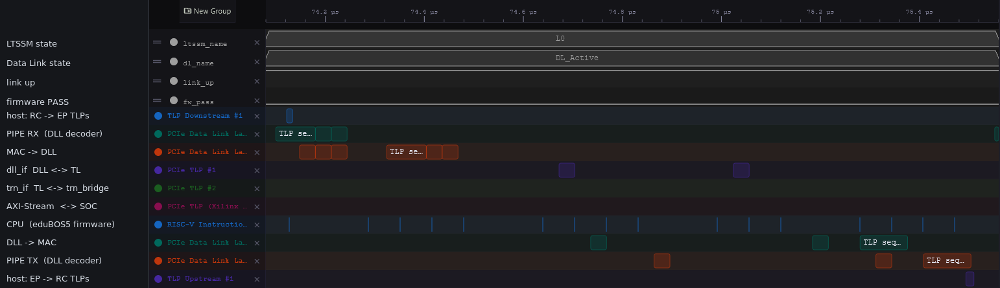

Zoomed in, from top to bottom: the CfgRd0 at the PIPE and after the MAC (74.08 to 74.46 µs), the TL at `dll_if` and the `Ack seq=0` going out (74.66 to 75.10 µs), the `UpdateFC-NP VC0 H=33 D=1` (75.15 to 75.26 µs) and the CplD going out (75.14 to 75.52 µs). The Pro decoder's labels at `dll_if` stay cut here; they are whole in the [TL's table](../2.rtl/5.tlp/README.md#viewing-the-tl-in-wavecrux), rows 1 and 2:

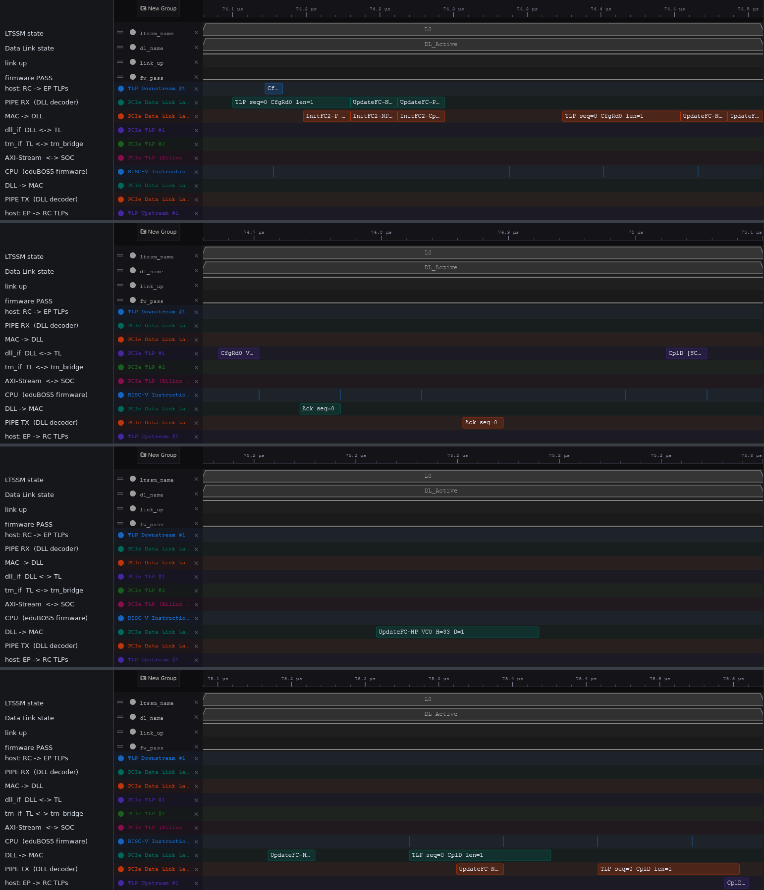

| Time | Where | Decoded | Step |
|---|---|---|---|
| 74.096 µs | PIPE RX | `TLP seq=0 CfgRd0 len=1` | STP on the link, scrambled |
| 74.320 µs | MAC -> DLL | `TLP seq=0 CfgRd0 len=1` | MAC receive, 7 PCLK |
| 74.704 µs | `dll_if` | `CfgRd0 Vendor ID/Device ID · 00:00.2 tag 0x00` | DLL receive with the LCRC check, 12 PCLK; `Ack seq=0` goes back at 74.74 µs |
| 75.056 µs | `dll_if` | `CplD [SC] Vendor ID/Device ID = 0x00011234` | the TL, 11 PCLK; `UpdateFC-NP H=33` gives the credit back at 75.18 µs |
| 75.280 µs | DLL -> MAC | `TLP seq=0 CplD len=1` | DLL transmit, 7 PCLK |
| 75.408 µs | PIPE TX | `TLP seq=0 CplD len=1` | MAC transmit, 4 PCLK |

1.31 µs, 41 PCLK, from STP in to STP out. The times in this table and the next are the PCLK edge that samples the STP, or the first beat at `dll_if`, `trn_if` and the AXI-Stream; the PCIe TLP decoders' rows start one PCLK, 32 ns, earlier, at the start of that clock (74.672 µs for the CfgRd0 at `dll_if`).

**A memory read, down to the firmware and back.** The last request, MRd32 of BAR0 + 0x010 (a: the host sends it, b: the SOC takes it, c: the SOC sends the CplD, d: the host has it):

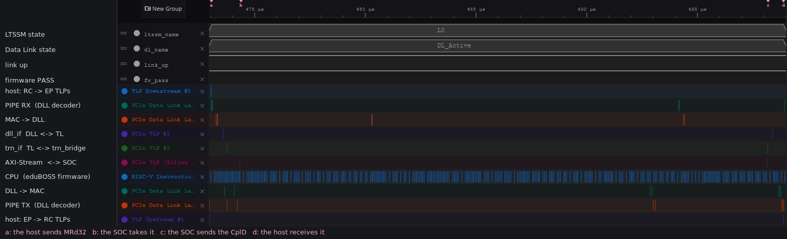

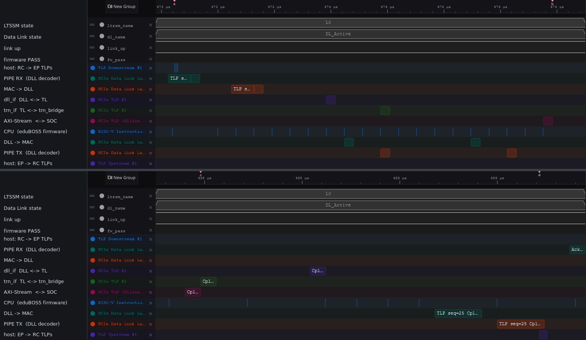

Zoomed in on the PIPE and the MAC, `TLP seq=29 MRd32 len=1` coming in (472.98 to 473.32 µs) and `TLP seq=25 CplD len=1` going out (498.62 to 498.96 µs):

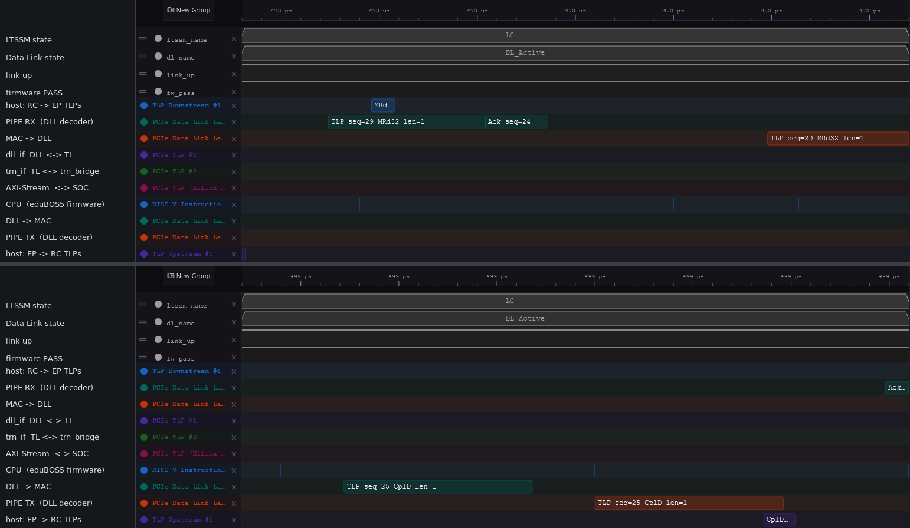

The Pro decoders' table, filtered on the address 0x2A784010, holds the rest: the first MWr32 and MRd32 to it (tags 0x16, 0x17) and this MRd32 (tag 0x1D), at `dll_if` (`PCIe TLP #1`), `trn_if` (`#2`) and the AXI-Stream (`Xilinx 7 Series AXIS`). Each CplD gives the request it answers, the requests at the AXI-Stream have `bar_hit` BAR0, and the latency is the time from request to CplD at that boundary. The `bar_hit`, `latency` and `tag` columns are further right in the same table; we put them next to the label:

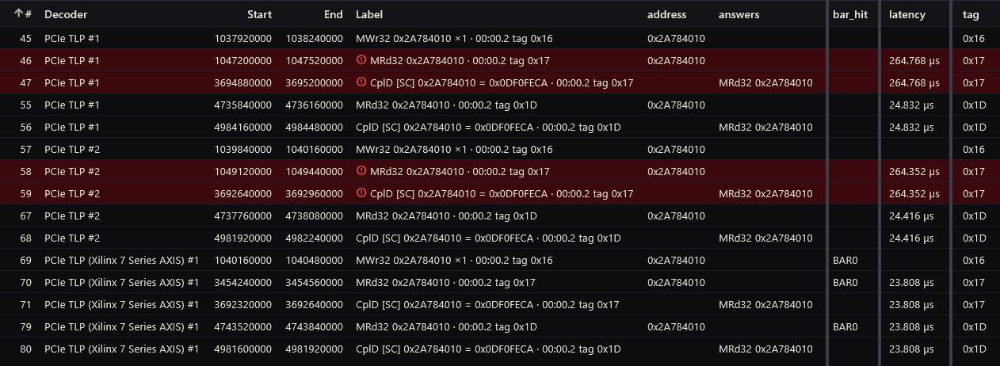

| Time | Where | Decoded | Step |
|---|---|---|---|
| 473.008 µs | PIPE RX | `TLP seq=29 MRd32 len=1` | STP on the link |
| 473.232 µs | MAC -> DLL | `TLP seq=29 MRd32 len=1` | MAC receive, 7 PCLK |
| 473.616 µs | `dll_if` | `MRd32 0x2A784010 · 00:00.2 tag 0x1D` | DLL receive, 12 PCLK |
| 473.808 µs | `trn_if` | `MRd32 0x2A784010` | the TL: queue, ordering, BAR0 hit, 6 PCLK |
| 474.384 µs | AXI-Stream | `MRd32 0x2A784010`, `bar_hit` BAR0 | the SOC takes it once the firmware has released the previous request |
| 498.192 µs | AXI-Stream | `CplD [SC] 0x2A784010 = 0x0DF0FECA` | the firmware, 23.8 µs |
| 498.224 µs | `trn_if` | `CplD [SC]` | `trn_bridge`, 1 PCLK |
| 498.448 µs | `dll_if` | `CplD [SC] 0x2A784010` | the TL's TX buffer, which takes a TLP whole before it sends it, 7 PCLK |
| 498.672 µs | DLL -> MAC | `TLP seq=25 CplD len=1` | DLL transmit, 7 PCLK |
| 498.800 µs | PIPE TX | `TLP seq=25 CplD len=1` | MAC transmit, 4 PCLK |

25.8 µs from STP in to STP out, 23.8 µs of it in the firmware: the latency of this MRd32 is 24.8 µs at `dll_if`, 24.4 µs at `trn_if` and 23.8 µs at the AXI-Stream. The payload reads `0x0DF0FECA`, byte 0 first: the host wrote 0xcafef00d little-endian. Every layer shows the same tag, 0x1D, and the Pro decoders pair the CplD with this MRd32 at each of them. The first MRd32 to this address (tag 0x17) waited 264 µs; the [TL section](../2.rtl/5.tlp/README.md#viewing-the-tl-in-wavecrux) shows where.

**On the serial line** (`PHY=rtl`). The first CfgRd0 again, with Cologne Chip's PIPE logic and the SerDes BFM below the MAC: the serial-line decoders recover it from the 1-bit line. It is on the line at 80.47 µs and at the PIPE about 0.4 µs later (STP at 80.864 µs: bit lock, 8b/10b, word alignment, elastic buffer); its CplD leaves the PIPE at 82.176 µs and is on the line about 0.13 µs after:

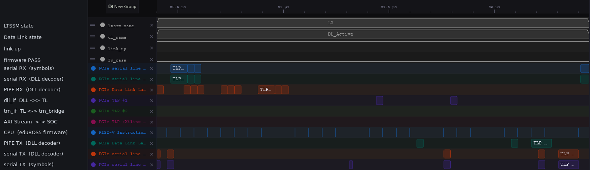

Zoomed in on the line: the CfgRd0 coming in, `TLP frame seq=0 (18 symbols)` and `TLP seq=0 CfgRd0 len=1` (80.43 to 80.62 µs), and its CplD going out, `TLP seq=0 CplD len=1` at the PIPE and then on the line, `TLP frame seq=0 (22 symbols)` (82.14 to 82.40 µs):

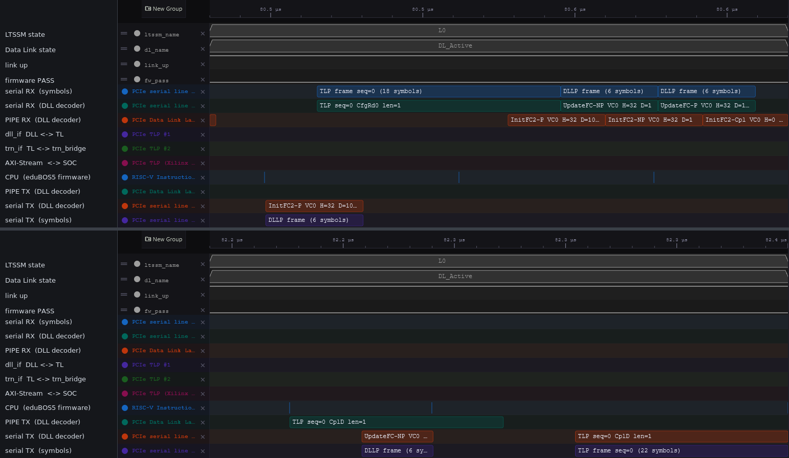

### Choosing the user code

Each VProc node runs a C/C++ program whose entry point is `VUserMain<n>()`, `n` being the node number. The make file compiles these programs into `obj/<sim>/libuser.a` and links it into the simulation. Four variables, set on the command line, choose what goes in:

| Variable | Default | What it does |
|---|---|---|
| `USER_C` | `VUserMain1.cpp VUserMain2.cpp` | the source files: one `VUserMain<n>` per node (1 = host, 2 = mock EP), plus any helper files they need |
| `USRCODEDIR` | `5.sim/usercode` | the directory all of `USER_C` is read from; it is also on the include path |
| `OPTFLAG` | `-g` | compiler flag for the user code; `-g` keeps it debuggable, `-O2` makes it faster |
| `USRSIMFLAGS` | empty | extra simulator flags, e.g. a define: `+define+X` for Verilator, `-DX` for Icarus |

```sh
make USER_C="VUserMain1.cpp VUserMain2.cpp my_checks.cpp" run   # add a helper file
make USRCODEDIR=$HOME/tests/cfg-walk run                         # another host program, same file names
```

A different test is therefore a different `USER_C` or `USRCODEDIR`, with no change to the make file. Run `make clean` after changing `OPTFLAG`: object files already built are not recompiled. `make help` lists the variables.

### Verilator and Icarus, side by side

The same test bench on both simulators (2026-10-20, WSL2, Verilator 5.052, Icarus Verilog 13.0, single runs; wall-clock times depend on host load):

| | Verilator | Icarus |
|---|---|---|
| Host results (`===>` lines) | 30, identical | 30, identical |
| LTSSM steps (`--->` lines) | 26 | 26 |
| Link display lines (TL, DL) | 980 | 980 |
| Simulated time at the end | 19.194 µs | 19.194 µs |
| Wall-clock time | 0.7 s | 32.5 s |
| Speed | 27 µs simulated per s | 0.59 µs simulated per s |
| C models reached via | DPI-C | VPI |
| Electrical idle on the line | `0` plus a side-band | `Z` on the wire |

Same results, same link-training steps, same end time. Verilator, compiled to a native executable, is about 46 times faster.

Both build `ltssm.c` with `LTSSM_ABBREVIATED` ([build defines](#build-defines)). Until 2026-10-20 only the Icarus library had it, so Verilator sent 1024 TS1 (65 µs more) and ended at 84 µs.

### Build defines

`LTSSM_ABBREVIATED` shortens pcieVHost's link training (`ltssm.c`): 16 TS1 in Polling.Active instead of the spec's 1024, and a Detect.Quiet timeout of 1500 cycles instead of 12 ms. The link reaches L0 through the same steps, only sooner. Both simulators use it.

| Define | Set in | Effect | Origin |
|---|---|---|---|
| `LTSSM_ABBREVIATED` | `Makefile` (Verilator), `tools/build-vip.sh` (Icarus) | shortened link training, above | VIP |
| `EXCLUDE_LTSSM` | `Makefile` | leaves the LTSSM out of the pcieVHost model; the user code links `ltssm.c` instead | VIP |
| `VPROC_SV` | `Makefile`, `tools/build-vip.sh`, `tb.f` | VProc over SystemVerilog DPI-C (Verilator) | VIP |
| `ICARUS` | `Makefile`, `tools/build-vip.sh` | VProc over VPI (Icarus) | VIP |
| `EXTERN_VPI_TABLE` | `tools/build-vip.sh` (Icarus) | VProc takes its system-task table from pcieVHost's `veriuser.c` | VIP |
| `VPROC_BYTE_ENABLE` | `Makefile`, `tb.f` | byte enables on the VProc bus, in VProc and pcieVHost | VIP |
| `_REENTRANT` | `tools/build-vip.sh` (Icarus) | thread-safe C library: each VProc node runs in a thread | C library |
| `VPROC`, `VPROC_PLI_VPI` | `Makefile`, `tools/build-vip.sh` | none in this VIP version | VIP |
| `DUMP` | `Makefile` (`DUMP=1`) | `tb.sv` writes `tb.fst` | ours |

### From XSIM to Verilator, via Icarus

openPCIE runs its co-simulation on AMD's XSIM, because the encrypted Artix-7 hard macros left no other choice. **The pcieVHost setup we took from openPCIE did not run on Verilator.** The upstream model has had Verilator support since `VERSION_1_0_0` (2024-08-27), with its own Verilator make flow since `VERSION_1_0_1` (2024-09-29); both twins use `VESRSION_1_9_3` (sic, 2026-06-13). But the openPCIE integration (libraries, file list, wiring) was built for XSIM only. Here all RTL is open, so the co-simulation moved to Verilator, the fast one, and Icarus. Each step on the way taught something about the models:

1. **Libraries built from source, per simulator.** XSIM loaded prebuilt `libcosimlnx.a` / `libpcielnx.a`. Verilator reaches the C models through DPI-C, Icarus through VPI, and the two need different builds of the same sources, so [`tools/build-vip.sh`](tools/build-vip.sh) builds both: `libcosimlnx.a` / `libpcielnx.a` for DPI-C, `libcosimica.a` / `libpcieica.a` for VPI. The VPI library also carries pcieVHost's `veriuser.c`, the table that registers the models' system tasks with Icarus.
2. **Every referenced module must exist.** The pcieVHost wrappers instantiate `clkmux` and `Serialiser` (from pcieVHost's `verilog/lib`), which the earlier XSIM file list never compiled. Verilator wants every module the design references, so the VIP build now collects them.
3. **Electrical idle: `Z` or a side-band.** A PCIE line that is electrically idle carries no signal, which a 4-state simulator (Icarus, XSIM) models as `Z`. Verilator is 2-state, it has no `Z`, so under Verilator `pcieVHostPipex1` drives idle as all zeros and adds two ports, `ElecIdleOut` and `ElecIdleIn`, for the models to tell each other. The test bench cross-connects them. Left open, the run still gives the same results, but about 15 times slower (35.4 s instead of 2.4 s, 2026-10-18): the side-band is what keeps Verilator fast through link training. Icarus needs none of this; it has `Z`.
4. **openPCIE's LTSSM patch does not belong here.** On openPCIE the model plays the EP, an upstream port, against a real `PCIE_2_1` downstream port, and the patch makes it spec-correct: an upstream port keeps sending Link/Lane = PAD in its TS1 ordered sets until the downstream port assigns the numbers. Upstream's model takes a shortcut that only works against another copy of itself. Our mock EP pairs the patched EP model with the model's own RC side, which still expects that shortcut, and the link deadlocks in Configuration.Start, on both simulators. Here the model plays the RC, so there is nothing for the patch to fix: we use upstream's `ltssm.c` as is, and both sides reach L0.
5. **Macros before models.** The pcieVHost models use macros (`WsTimeScale`, `RegDel`, the comma symbols, the register map) defined in its headers. Under Verilator the first file in the list happened to pull them in for all others; Icarus has no such luck. [`tb.f`](tb.f) now names `allheaders.v` first, for both.
6. **Portable delays.** Icarus rejected the test bench's `#(N * 1ps)` delays. The file's timescale is 1 ps, so plain numbers mean the same and work everywhere; the run limit is a 64-bit constant, as 10 ms in picoseconds overflows 32 bits.

### VIP versions and local changes

| Component | In use | Source |
|---|---|---|
| VProc | 1.13.4 | [wyvernSemi/vproc](https://github.com/wyvernSemi/vproc) |
| pcieVHost **(modified, see below)** | 1.9.3 | [wyvernSemi/pcievhost](https://github.com/wyvernSemi/pcievhost) |
| mem_model **(wrapped, see below)** | `main` c7b9c62 | [wyvernSemi/mem_model](https://github.com/wyvernSemi/mem_model) |
| rv32 ISS **(modified, see below)** | `main` 774d84fa | [wyvernSemi/rv32](https://github.com/wyvernSemi/rv32) |

The upstream files are copied in [`vip`](vip/README.md), with these changes made by [`tools/vip-import.sh`](tools/vip-import.sh):

| File | Change | Why |
|---|---|---|
| pcieVHost `verilog/pcieVHost/pcieVHost.v` | VProc `BE` and `Burst` ports, left open | we build VProc with `VPROC_BYTE_ENABLE` |
| pcieVHost `verilog/headers/test_defs.v` | `` `fatal`` calls `tb.Fatal` | our test bench top is `tb` |
| pcieVHost `src/displink.c`, `src/pcie_vhost_map.h`, `pcieVHost.v`, `pcieVHostPipex1.v` | transaction taps: TLP and DLLP ports ([`pcievhost-taps.patch`](models/pcievhost/pcievhost-taps.patch)) | waveform decoders need the TLP stream; the model keeps it in C |
| pcieVHost `verilog/headers/pcie_vhost_map.v` | added: generated from `src/pcie_vhost_map.h` | upstream's make files generate it |
| pcieVHost `src/ltssm.c` | none: upstream as is | openPCIE's LTSSM patch deadlocks here (step 4 above) |
| [`models/cosim/mem_model.sv`](models/cosim/mem_model.sv) | wraps upstream `mem_model.v` (as `f_mem_model.v`) in Verilator `lint_off` pragmas | keeps third-party code out of our lint |
| rv32 `src/rv32csr_cpu.cpp` (in openPCIE's `rv32-openpcie.patch`) | the timer-compare check in `process_interrupts()` no longer charges cycles | it added 2 cycles to every instruction |
| rv32 `src/rv32i_cpu.cpp` (same patch) | `sw`, `sh` add the store extra cycles | upstream adds the load ones |
| [`models/rv32/usercode/rv32_timing_config.h`](models/rv32/usercode/rv32_timing_config.h) | PicoRV32, eduBOS5 2-/3-stage timing tables, measured on openPCIE's SOC RTL | see openPCIE's [Our Local VIP Improvements](https://github.com/chili-chips-ba/openPCIE/blob/main/5.sim/README.md#our-local-vip-improvements) |
| [`models/rv32/usercode/VUserMain0.cpp`](models/rv32/usercode/VUserMain0.cpp) | no fetch/load wait states; bus credit; waits for reset release, restarts on reset | the same |

The rv32 integration code in `models/rv32/usercode` is the same as openPCIE's.

## Introduction

The top-level test bench drives the DUT's PCIE link with the [pcieVHost](https://github.com/wyvernSemi/pcievhost) VIP: a C model of a PCIE 1.1/2.0 link partner, connected to the logic simulation through the [VProc](https://github.com/wyvernSemi/vproc) virtual processor. VProc lets a program compiled natively on the host run "inside" an HDL component, in lock-step with the simulation; pcieVHost is such a program, wrapped so that its PCIE lanes appear as ports. It was designed as a root complex, the role it plays here, and has endpoint features too, enabled by a parameter; they are [limited](models/pcievhost/README.md#endpoint-feature-limitations) and meant as a target for testing the root complex side.

<p align=center>

</p>

The picture is forward-looking: it shows the final setup, with the EP RTL in place, to guide developers in building it. Part of it does not exist yet: the `CPU=rtl | vproc | iss` switch. With `DUT=rtl`, `tb.sv` puts `pcie_top` (MAC + DLL + TL + SOC with eduBOS5) under the host, which sits in the `phy_top` socket, or with `PHY=rtl` all of `top`, the host on the serial line; with `DUT=mock` it connects the host straight to the mock EP.

Each VProc instance is a node with its own program, `VUserMain<n>` for node `n`:

| Node | Model | Program | Role |
|---|---|---|---|
| 1 | `RCPIPEx1__pcieVHost` | [`usercode/VUserMain1.cpp`](usercode/VUserMain1.cpp) | the host: trains the link, enumerates the EP (IDs, BAR sizing and assignment, capabilities), then reads and writes BAR0 |
| 2 | `EPPIPEx1__pcieVHost_DUT` | [`usercode/VUserMain2.cpp`](usercode/VUserMain2.cpp) | the mock EP ([`stubs`](stubs/README.md)), an option next to the EP RTL + firmware: `DUT=mock` |
| 0 | `soc_cpu.VPROC` | native C/C++, or the rv32 ISS | the SOC's CPU, in place of eduBOS5, once the EP RTL is in (below) |

The model can print the traffic of both link directions to the console, layer by layer; [`hex/ContDisps.hex`](hex/ContDisps.hex) selects what is shown.

## Scope: unit debug, then top-level validation

Every layer is covered twice, on purpose. Block-level test benches debug each unit on its own. The top level then validates them together, with an independent host. This matters most for the PHY: it comes from Cologne Chip, and only the top level checks it against our MAC, DLL, TL and firmware.

| Level | Where | Purpose | Link partner |
|---|---|---|---|
| Top | `5.sim` (here) | validates the units together: MAC + DLL + TL RTL and firmware (enumeration, configuration, PIO); with `PHY=rtl`, also Cologne Chip's PIPE and SerDes | `RCPIPEx1__pcieVHost` |
| DLL over PIPE + PHY | [`2.rtl/4.dll/sim`](../2.rtl/4.dll/sim) | unit debug: DLL, MAC/LTSSM, PIPE and SerDes BFM on the serial line | a second copy of the same stack |
| PIPE + PHY | [`2.rtl/1.phy/3.sim`](../2.rtl/1.phy/3.sim) | unit debug: Cologne Chip's PIPE logic over the GateMate SerDes; the [SerDes BFM](../2.rtl/1.phy/2.serdes-model) against the vendor model | the vendor's PIPE test case; the BFM, looped back |

How to run each, and today's status: [Simulation, layer by layer](../2.rtl/README.md#simulation-layer-by-layer).

`PHY` sets the top level's depth:

- **`vproc_rc`**: the host sits at the PIPE. Fast (eight symbols per 31.25 MHz clock), and a failure points at MAC, DLL, TL or firmware.
- **`rtl`**: the real PHY is in, and the host drives the serial line. Slower (2.5 Gb/s bit rate), but it covers the whole stack. It runs on the open-source [SerDes BFM](../2.rtl/1.phy/2.serdes-model), which is checked against the vendor's NDA model ([equivalence checking](../2.rtl/1.phy/2.serdes-model/0.doc/equivalence-checking.md)), so anyone can run it.

### A host already proven against real silicon

`RCPIPEx1__pcieVHost` is the pcieVHost model in our wrapper [`PIPEx1__pcieVHost`](models/PIPEx1__pcieVHost.sv), around upstream's `pcieVHostPipex1`, fixed to the RC role ([`models/RCPIPEx1__pcieVHost.sv`](models/RCPIPEx1__pcieVHost.sv)). The same model and PIPE wrapper were validated on [openPCIE](https://github.com/chili-chips-ba/openPCIE/tree/main/5.sim) against the AMD `PCIE_2_1` hard macro: link training, flow control, TLPs and completions, end to end. There the roles were the other way round, the model the EP and the hard macro the RC. What that run established is that the model and the AMD hard macro speak the same PCIE. An EP that passes against this model in simulation therefore stands a better chance of working on the first try in hardware, when a physical Artix-7, running openPCIE as the RC, drives our GateMate EP over the [openPCIE backplane](https://github.com/chili-chips-ba/openPCIE/tree/main/1.pcb).

## VProc Software

A VProc program is ordinary C or C++ with one difference: its entry point is `VUserMain<n>()`, with C linkage, instead of `main()`, because the simulator already has a `main()` and each node has its own program. Under it, VProc's scheduler talks to the simulator over DPI-C (Verilator) or VPI (Icarus); the program does not see the difference. VProc offers a low-level C API and a C++ one, the `VProc` class in `VProcClass.h` (its headers are in `$VIP_DIR/include`, see [Running the co-simulation](#running-the-co-simulation)):

```c++
VProc (const uint32_t node);

int  write (const unsigned addr, const unsigned  data, const int delta=0);
int  read  (const unsigned addr,       unsigned *data, const int delta=0);
int  tick  (const unsigned ticks);
```

Addresses are byte addresses; `delta` stays at its default. `tick()` advances simulation time by a number of clock cycles of the clock the node is connected to, without a bus transaction. Finer accesses exist too, `writeByte`, `writeHword`, `writeWord` and their `read` twins; the [VProc manual](https://github.com/wyvernSemi/vproc/blob/master/doc/VProc.pdf) has the rest.

A program can also reach the sparse memory model directly, through `mem.h` (C functions, so `extern "C"` from C++):

```c++
void     WriteRamByte  (const uint64_t addr, const uint32_t data, const uint32_t node);
void     WriteRamHWord (const uint64_t addr, const uint32_t data, const int little_endian, const uint32_t node);
void     WriteRamWord  (const uint64_t addr, const uint32_t data, const int little_endian, const uint32_t node);
uint32_t ReadRamByte   (const uint64_t addr, const uint32_t node);
uint32_t ReadRamHWord  (const uint64_t addr, const int little_endian, const uint32_t node);
uint32_t ReadRamWord   (const uint64_t addr, const int little_endian, const uint32_t node);
```

Being C, they have no default arguments. `node` here selects a memory space, not a VProc node; we use one, 0. Every `mem_model` instance in the HDL sees the same memory as this API, so programs and logic can exchange data through it.

<p align="center">
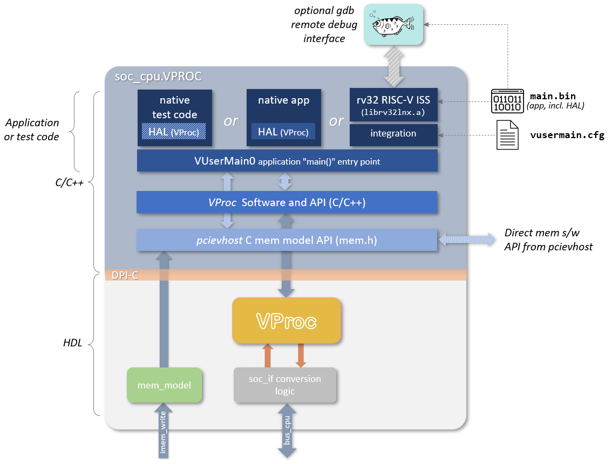
</p>

### The CPU node: three ways to run the SOC's software

Once the EP RTL is in, node 0 can stand in for eduBOS5 in the SOC's CPU socket ([`models/soc_cpu.VPROC.sv`](models/soc_cpu.VPROC.sv), on the same `mem_if` bus), in the same three ways as on openPCIE:

- **RTL:** eduBOS5 itself runs `firmware.hex`, as in the bitstream. The reference.
- **Native:** a C/C++ program compiled for the host drives the bus. With the co-simulation HAL ([below](#co-simulation-hal)) the firmware's own sources compile this way, and run much faster than on the RTL core.
- **ISS:** the [rv32](https://github.com/wyvernSemi/rv32) instruction set simulator runs the real RISC-V `firmware.elf`: real instructions, interpreted rather than executed by RTL. Its integration program ([`models/rv32/usercode`](models/rv32/usercode)) routes each load and store to the memory model, to a bus transaction on the SOC, or back to the ISS. The ISS sources, with openPCIE's fixes, are in [`vip/rv32`](vip/rv32).

The ISS reads its options from `vusermain.cfg`, in the form of a command line for `vusermain0`. A set of timing models makes it count cycles like a given core; `-V EDUBOS5STG2` (2-stage eduBOS5) or `-V EDUBOS5STG3` match ours.

**The ISS in WaveCrux.** The SOC's `rvfi` stays 0 under the ISS: the ISS runs its instruction loop in C and calls back only for memory, unimplemented instructions and interrupts, so no retired instruction reaches the HDL. Its loads and stores to the SOC still show as bus transactions (`mem_if`). A subset (`rvfi_valid`, `rvfi_pc_rdata`, `rvfi_insn`) would need a per-instruction hook in the ISS and a VProc write for every instruction, slowing it down. Not worth it: the ISS has better tools of its own, `-r` (run-time disassembly in the log) and `-g` (gdb). WaveCrux matters for the RTL CPU, which has neither.

One of the options is <tt>-h</tt> for a help message, which is as shown below:
```
Usage:vusermain0 -t <test executable> [-hHebdrgxXRcI][-n <num instructions>]
      [-S <start addr>][-A <brk addr>][-D <debug o/p filename>][-p <port num>]
      [-l <line bytes>][-w <ways>][-s <sets>][-j <imem base addr>][-J <imem top addr>]
      [-P <cycles>][-x <base addr>][-X <top addr>][-V <core>]
   -t specify test executable/binary file (default test.exe)
   -B specify to load a raw binary file (default load ELF executable)
   -L specify address to load binary, if -B specified (default 0x00000000)
   -n specify number of instructions to run (default 0, i.e. run until unimp)
   -d Enable disassemble mode (default off)
   -r Enable run-time disassemble mode (default off. Overridden by -d)
   -C Use cycle count for internal mtime timer (default real-time)
   -a display ABI register names when disassembling (default x names)
   -T Use external memory mapped timer model (default internal)
   -H Halt on unimplemented instructions (default trap)
   -e Halt on ecall instruction (default trap)
   -E Halt on ebreak instruction (default trap)
   -b Halt at a specific address (default off)
   -A Specify halt address if -b active (default 0x00000040)
   -D Specify file for debug output (default stdout)
   -R Dump x0 to x31 on exit (default no dump)
   -c Dump CSR registers on exit (default no dump)
   -g Enable remote gdb mode (default disabled)
   -p Specify remote GDB port number (default 49152)
   -S Specify start address (default 0)
   -I Enable instruction cache timing model (default disabled)
   -l Specify number of bytes in icache line (default 8)
   -w Specify number of ways in icache (default 2)
   -s Specify number of sets in icache (default 256)
   -j Specify cached IMEM base address (default 0x00000000)
   -J Specify cached IMEM top address (default 0x7fffffff)
   -P Specify penalty, in cycles, of one slow mem access (default 4)
   -x Specify base address of external access region (default 0xFFFFFFFF)
   -X Specify top address of external access region (default 0xFFFFFFFF)
   -V Specify RISC-V core timing model to use (default "DEFAULT")
   -h display this help message
```

## Debugging Code

The simulation is a native process, and the user programs are part of it, so the host `gdb` debugs them directly; build them with `-g` (the default `OPTFLAG`):

```sh
gdb --args obj/verilator/Vtb                                          # Verilator
gdb --args vvp -n -M obj/icarus -m VProc obj/icarus/sim               # Icarus
(gdb) break VUserMain1
(gdb) run
```

There is no simulator kernel to attach to, as there was with XSIM: the breakpoint stops the whole simulation, and inspecting the C++ state of the host program, a TLP it built or the BAR values it read, works as in any program.

Code running on the rv32 ISS is debugged with the RISC-V `gdb` instead: with `-g` in `vusermain.cfg`, the ISS opens a TCP port and prints its number (e.g. `RV32GDB: Using TCP port number: 49152`), and `(gdb) target remote :49152` connects to it. The [ISS manual](https://github.com/wyvernSemi/rv32/blob/main/iss/doc/iss_manual.pdf) has the details.

## The mem_model Co-Simulation Sparse Memory Model

[mem_model](https://github.com/wyvernSemi/mem_model) is a sparse memory, written in C as part of the pcieVHost software: it maps a 64-bit address space and allocates pages only when they are touched. Programs reach it through the API above; logic reaches the same memory through the `mem_model` HDL component, which may be instantiated any number of times. That shared space is how a VProc program and the simulated logic hand data to each other. Details: [`models/cosim/README.md`](models/cosim/README.md).

## Driving the PCIE Link

The EP has a single x1 PIPE port, 64 bits wide, as Cologne Chip's PIPE. `pcieVHostPipex1`, the PIPE wrapper of the pcieVHost model, drives it with Gen1 traffic:

<p align=center>

</p>

On a 64-bit PIPE, eight symbols travel per PIPE clock, so `pclk` runs at `pcieclk`/8: 31.25 MHz against the 250 MHz symbol clock of Gen1. Configuring and driving the model: [`models/pcievhost/README.md`](models/pcievhost/README.md).

## Co-simulation HAL

`make -f MakefileCSR` in `4.build` generates, from the single register map `csr_build/csr.rdl`, the CSR RTL, the C header the firmware uses (`csr.h`), and two C++ HALs: `csr_hw.h` for the hardware and `csr_cosim.h` for co-simulation ([`sysrdl_cosim.py`](../4.build/sysrdl_cosim.py)). Both present the same API, a hierarchy of register objects that mirrors the RDL, so the same application source compiles for the RISC-V target and for a native VProc program on node 0; only the header behind it changes, and with it whether an access is a pointer dereference or a VProc bus transaction.

Two more things differ between the two builds, and the generated headers cover both:

- **The entry point.** The hardware build starts at `main()`, the co-simulation at `VUserMain0()`. The headers define `PCIEMAIN` as one or the other, so the application writes `void PCIEMAIN (void)`.
- **Delays.** A delay loop on the target is wasted simulation time in co-simulation. Wrap delays in one function whose co-simulation version converts time into clock cycles and calls VProc's tick. `csr_cosim.h` defines `SOC_CPU_CLK_PERIOD_PS` for that (16000 ps unless defined before the include) and `SOC_CPU_VPNODE`, the CPU node (0; option `-v` of `sysrdl_cosim.py`).

## References:
- [Logic sim using pcieVHost and 3rd Party PCIe](https://www.linkedin.com/pulse/case-study-logic-simulation-environment-using-third-party-southwell-tyere)
- [VProc](https://github.com/wyvernSemi/vproc)
- [mem_model](https://github.com/wyvernSemi/mem_model)
- [PCIe VHost Model](https://github.com/wyvernSemi/pcievhost)
- [rv32 RISC-V ISS](https://github.com/wyvernSemi/rv32/tree/main/iss)
- [cocotbext-pcie](https://github.com/alexforencich/cocotbext-pcie): Alex Forencich's PCIE models for cocotb (Python)
- [WaveCrux PCIE decoders](https://github.com/Ferrite-Engineering/wavecrux-decoders/tree/main/decoders/pcie): PIPE and DLL traffic as transactions in the waveform
- [WaveCrux RV32 ISA decoder](https://github.com/Ferrite-Engineering/wavecrux/tree/main/assets/decoders/isa/riscv): RISC-V instructions in the waveform
- [SystemRDL](https://www.accellera.org/downloads/standards/systemrdl)
- [PeakRDL and SystemRDLcompiler](https://github.com/SystemRDL)
