

This project is the direct continuation of [openCologne](https://github.com/chili-chips-ba/openCologne), and it also firmly ties into [openPCIE](https://github.com/chili-chips-ba/openpcie).

The project aims to take _openCologne_ to a new level, not only by introducing **soft PCIE EndPoint core** to GateMate portfolio, but also by challenging and validating the new, fully opensource [nextPNR](https://github.com/YosysHQ/prjpeppercorn) tool suite.

  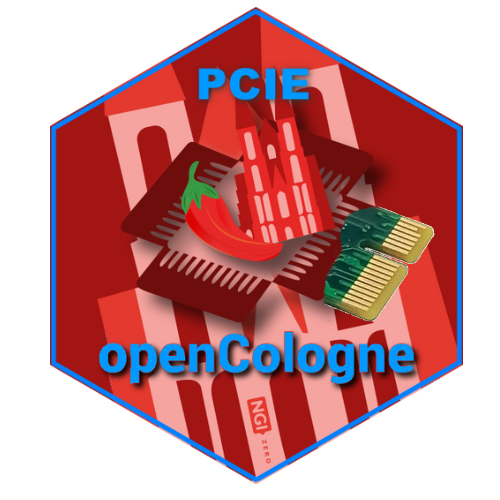

It aims to complement _openPCIE RootComplex_ with a layered EndPoint that's portable to other FPGA families, and even to [OpenROAD](https://github.com/The-OpenROAD-Project) ASICs, leaving only the PHY in the hard-macro (HM) domain. This is the only soft PCIE protocol stack in opensource at the moment.
> dev track to put together an opensource SerDes for wafer.space GlobalFoundries GF180MCU process node is in full swing

Our PCIE EP core comes with unique **Verification IP (VIP)** and two **PCIE cards for GateMate**. The new boards can host all three GateMate variants: A1, A2, A4 and are plug-and-play compatible with the vast assortment of 3rd-party carriers, including our opensource [PCIE Backplane](https://github.com/chili-chips-ba/openPCIE/tree/main/1.pcb/openpci2-backplane). 

The project aims for integration with LiteX, by expanding [LitePCIE](https://github.com/enjoy-digital/litepcie) portfolio, thus creating a strong foundation for the complete, end-to-end, community maintained _openCompute_ PCIE ecosystem.

### Minimal, yet functional PCIE EP core
 
The PCIE protocol is complex. It is also bloated -- Most of the real-life users don't use most of it 😇. To be fair, our project is about creating a minimal set of features, that is a barebones design that is still interoperable with the actual PCIE HW/SW systems out there.

Its scope is therefore limited to a demonstration of the **PIO writes and reads** only. Other applications, such as DMA, are not in our deliverables. They can later on be added on top of the protocol stack (i.e. PCIE "core") that this project is about.

The power states and transitions are supported only to the least extent possible, and primarily in relation to the mixed-signal SerDes, which is by definition the largest consumer. Our [PHY section](2.rtl/1.phy/README.md) delves into that topic.

While our commitment is to produce a **`Gen1`** EP, the design will from the get-go support the Gen2 throughput -- We intend to, on the best-effort bases, as a bonus, try to bring up 5Gbps links. However, the procedures for automatic up- and down- training of the link speed will not be implemented.

We **`only support x1 (single-lane)`** PCIE links. The full link width training is therefore omitted, keeping only the bare minimum, as needed to wake the link up from its initial down state**

> The GateMate die (A1) does not come with more than one SerDes anyway. While, in theory, a two-die A2 could support a 2-lane PCIE, that would turn everything on its head and become a major project of its own... one that would require splitting the PCIE protocol stack vertically, for implementation across two dice. Moreover, as we expect to consume most of the A1 for the PCIE stack alone, the A2 and A4 chips come into play as the banks of logic resources for the final user app.

We **`only support one Physical Function (PF0)`** and zero _Virtual Functions_ (VF). No _Traffic Classes_ (TC) and no _Virtual Channels_ (VC) either.

The **Configuration Space** registers, while retained in our PCIE IP core, are reduced to the bare-minimum, and hard-coded for most part. The _Base Address Registers_ (BARs) are, of course, programmable from the Root Port. We don't support 64-bit BARs, but only 32-bit, and only one address window: **BAR0**.

### References:

- **[PCIE Primer](http://www.anita-simulators.org.uk/wyvernsemi/articles/pci_express.pdf) by Simon Southwell** ✅
  
### Design Blueprint

  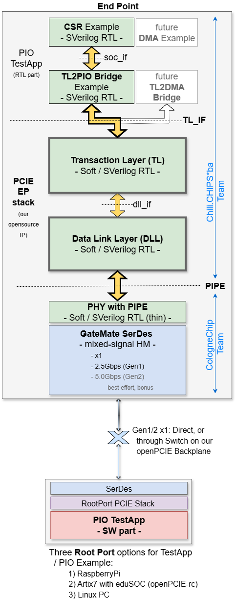

--------------------

# HW Architecture

### EP card: Intergalaktik ULX5M-M2

  <a href="https://canva.link/vyykwt6k7odhs3t" target="_blank" rel="noopener">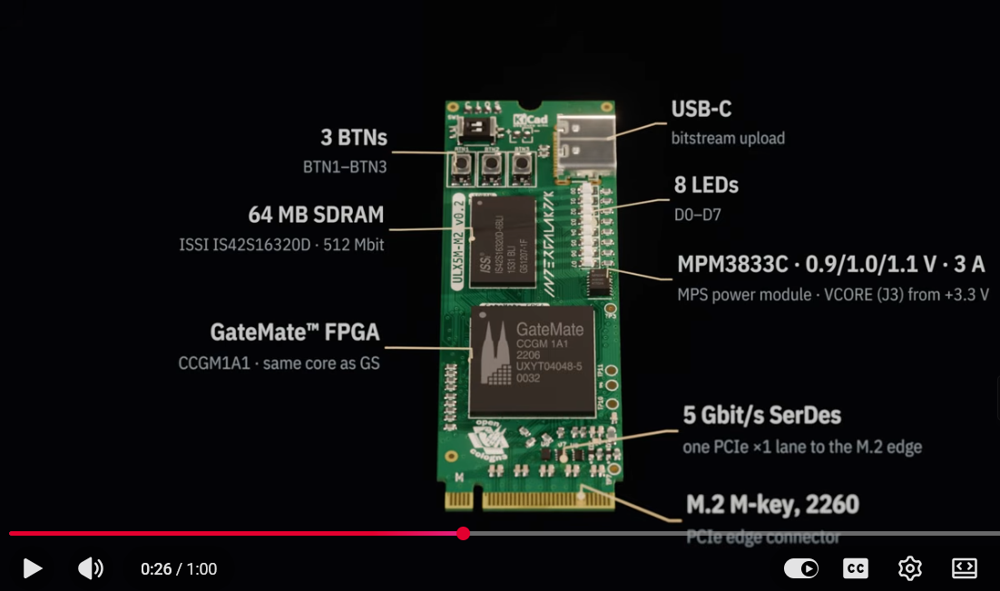</a>

The GateMate EP card is the ULX5M-M2 by [Intergalaktik](https://intergalaktik.eu) and [Radiona](https://radiona.org), in M.2 form factor; its sources are at [intergalaktik/ulx5m-m2](https://github.com/intergalaktik/ulx5m-m2).

### Test setup

  

For additional info, see the [openPCIE backplane page](https://www.chili-chips.xyz/openpcie-backplane-put-your-fpga-in-control).

Our GateMate EP is the [ULX5M-M2](1.pcb/README.md) card. It plugs into the [openPCIE backplane](https://github.com/chili-chips-ba/openPCIE/tree/main/1.pcb), where the [openPCIE](https://github.com/chili-chips-ba/openPCIE) Artix-7 drives it in the RC role, in two topologies: (1) **Direct**, our EP on the RC link, and (2) **Behind Switch**, through the PCIE switch of the backplane. For an EP the two should behave the same, but we still test them separately: behind the switch, our EP sits on another bus number, which it learns from the host's configuration writes and must return in the Completer ID of its Completions.

> That bus-number point is the one real difference for an EP. The EP takes its bus and device number from the Type 0 configuration writes it receives, and must put that number in every Completion it sends. With a direct link the bus number is often 1; behind the switch it's higher. A TL that hard-codes the bus number would pass the Direct test and fail Behind Switch.

We then also test it with a Raspberry Pi and a PC as the host.

For additional detail, please jump to [1.pcb/README.md](1.pcb/README.md)

--------------------

# PHY and PIPE (is not a dream)

  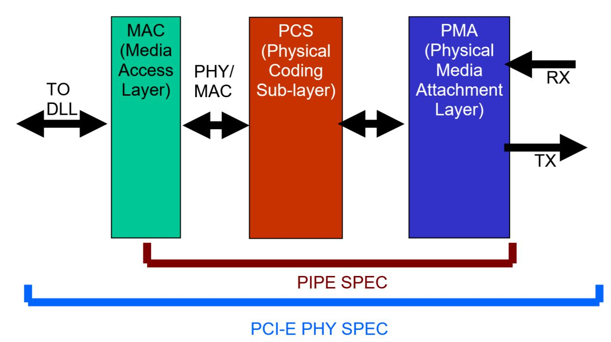

The GateMate SerDes has thus far not been used in the PCIE context. It is therefore reasonable to expect issues with physical layer, which may falter for signal integrity, jitter, or some other reason. Luckily, we have teamed up with Cologne Chip developers, who will own the PHY layer up to and including **P**hysical **I**nterface for **P**CI **E**xpress (PIPE) 👍. This technology-specific work is clearly separated in a directory of their own, see **`2.rtl/1.phy`**.

> By adhering to PIPE architecture, we avoid mixing the generic (i.e. "logic" only) design part with FPGA-specific RTL. This does not mean that all of our RTL is portable to other vendors, but rather that it is structured in a way that facilitates future ports, with only a thin layer of code behind PIPE interface that needs to be revisited. That's a small subsection of the overall design, thereby saving a good amount of porting effort.

--------------------

# RTL Architecture

There are two major elements in this design:
- **PCIE-capable SerDes** -- in our case Cologne Chip (CC) **proprietary** mixed-signal hard IP. They wrap it into a thin, soft adaptation layer (_phy_top_) and present in the form an industry-standard PIPE interface. To enable faster and public domain simulations, we have complemented this CC HM with an opensource SerDes BFM
- **PCIE protocol stack**: Our soft RTL that implements MAC/LTSSM, DLL and TL, crowned by an eduBOS5-based RISC-V SOC for application layer.

  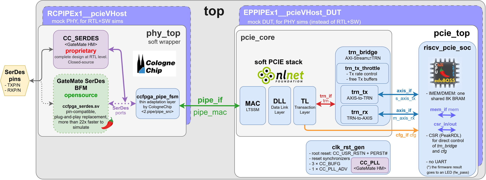

For additional detail, please jump to [2.rtl/README.md](2.rtl/README.md)

--------------------

# SW Architecture

 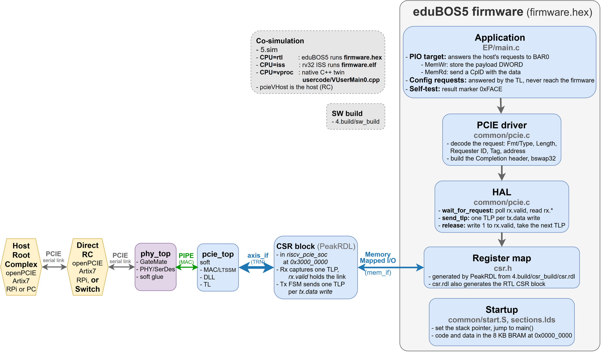

The EP firmware runs bare-metal on the eduBOS5 RISC-V core of our GateMate SOC. It answers the host's Memory requests (PIO); the soft TL answers the configuration requests.

On the host side, we test with:
1) **openPCIE Artix-7 RC** on the openPCIE backplane, Direct and Behind Switch: its bare-metal firmware enumerates our EP and runs the PIO write-read-validate test
2) **Raspberry Pi**
3) **PC**

For additional detail, please jump to [3.sw/README.md](3.sw/README.md)

--------------------

# Simulation Architecture

    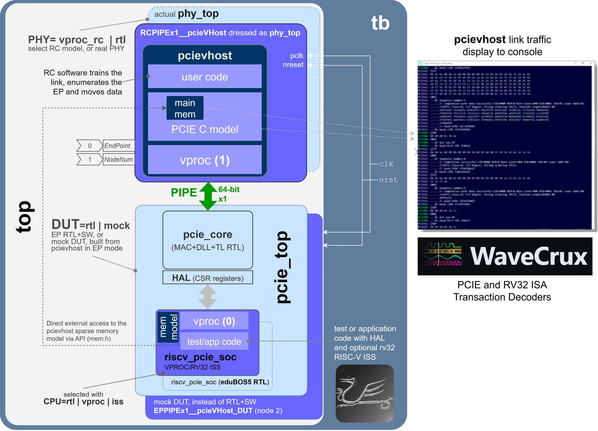

The [test bench](5.sim/README.md) runs on open-source simulators only, Verilator or Icarus Verilog. The host is the [_pcieVHost VIP_](https://github.com/wyvernSemi/pcievhost) in the RC role, `RCPIPEx1__pcieVHost`: it drives our DUT at its PIPE interface, trains the link and enumerates the EP. The top level focuses on the MAC, DLL and TL RTL and the firmware; the PIPE and the PHY below it are covered by their own [block-level test benches](5.sim/README.md#scope-unit-debug-then-top-level-validation), where the opensource SerDes BFM comes in. The same pcieVHost model has already run against the AMD `PCIE_2_1` hard macro on openPCIE, which raises the odds that our EP works on the first try against a physical Artix-7 RC on the openPCIE backplane.

### Coverage plan: every layer, against a known-good partner

Either half of the design can be swapped for pcieVHost, the same model that already ran against the AMD hard macro on openPCIE:

1. **`phy_top` → `RCPIPEx1__pcieVHost`** (pcieVHost as the RC): our MAC, DLL, TL and firmware get a full PCIE link partner at the PIPE interface. This is the top-level run.
2. **`pcie_top` → `EPPIPEx1__pcieVHost_DUT`** (pcieVHost as the EP, `DUT=mock`): the test bench and the host program run before our EP RTL exists. This is today's default.
3. **`phy_top` alone**, in its own [block-level test benches](2.rtl/README.md#simulation-layer-by-layer), with either SerDes: the vendor's `CC_SERDES` simulation model or our opensource SerDes BFM, with an [equivalence check](2.rtl/1.phy/2.serdes-model/0.doc/equivalence-checking.md) between the two.

The block-level runs also feed the [WaveCrux PCIE decoders](https://github.com/Ferrite-Engineering/wavecrux-decoders/tree/main/decoders/pcie), which show PIPE and DLL traffic as transactions ([DLL in WaveCrux](2.rtl/4.dll/README.md#viewing-the-dll-in-wavecrux)). Cologne Chip's own bench in the submodule drives their MAC + DLL with pcieVHost ([pictures](2.rtl/4.dll/README.md#simulation-with-pcievhost)). WaveCrux's [RV32 ISA decoder](https://github.com/Ferrite-Engineering/wavecrux/tree/main/assets/decoders/isa/riscv) can show the firmware's instructions the same way. The top-level run with our EP decodes all of it at once, every layer from the PIPE to the firmware and back ([EP in WaveCrux](5.sim/README.md#viewing-the-ep-in-wavecrux), [TL in WaveCrux](2.rtl/5.tlp/README.md#viewing-the-tl-in-wavecrux)).

* A [_VProc_](https://github.com/wyvernSemi/vproc) virtual processor based [`soc_cpu.VPROC`](5.sim/models/README.md#soc_cpuvproc) component, in place of the RTL CPU
  * Can run natively compiled test code
  * Can run the application compiled natively with the [auto-generated co-sim HAL](5.sim/README.md#co-simulation-hal)
  * Can run RISC-V compiled code using the [rv32 RISC-V ISS model](5.sim/models/rv32/README.md)
* Uses a C [sparse memory model](https://github.com/wyvernSemi/mem_model)
  * An [HDL component](5.sim/models/cosim/README.md) instantiated in logic gives logic access to this memory
  * An API is provided to _VProc_ running code for direct access from the _pcieVHost_ software, which implements this sparse memory C model.

More details on the architecture and usage of the test bench can be found in the [README.md](5.sim/README.md) in the `5.sim` directory.

## Co-simulation HAL

The PCIE EP control and status register harware abstraction layer (HAL) software is [auto-generated](5.sim/README.md#co-simulation-hal), as is the CSR RTL, using [`peakrdl`](https://peakrdl-cheader.readthedocs.io/en/latest/). For co-simulation purposes an additional layer is auto-generated from the same SystemRDL specification using [`systemrdl-compiler`](https://systemrdl-compiler.readthedocs.io/en/stable/) that accompanies the `peakrdl` tools. This produces two header files that define a common API to the application layer for both the RISC-V platform and the *VProc* based co-simulation verification environment. The details of the HAL generation can be found in the [README.md](5.sim/README.md#co-simulation-hal) in the `4.build/` directory.

More details of the test bench, the _pcievhost_ component and its usage can be found in the [5.sim/README.md](5.sim/README.md) file.
  

--------------------

# Implementation Workflow

 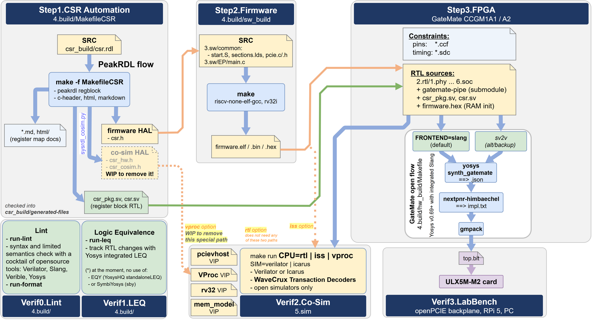

See [4.build/README.md](4.build/README.md)

--------------------

# Bringup, Debug and Lab Validation

1) **openPCIE backplane:** the ULX5M-M2 card in an M.2 slot, the openPCIE Artix-7 as the RC: link up, enumeration, PIO write-read-validate, (a) Direct and (b) Behind Switch
2) **Raspberry Pi:** enumeration and PIO from the Pi as the host
3) **PC:** the same with a PC as the host

#### References:
- [PCIE Utils](https://mj.ucw.cz/sw/pciutils)
- [Debug PCIE issues using 'lspci' and 'setpci'](https://adaptivesupport.amd.com/s/article/1148199?language=en_US)
- [fpgas.online: PCIE enumeration test](https://github.com/fpgas-online/fpgas.online-test-designs/blob/main/docs/tests/pcie-enumeration.md)

## PCIE Protocol Analyzer

#### References
- [PCIE Sniffing](https://ctf.re/pcie/experiment/linux/keysight/protocol-analyzer/2024/03/26/pcie-experiment-1)
- [Stark 75T Card](https://www.ebay.com/itm/396313189094?var=664969332633)
- [ngpscope](http://www.ngscopeclient.org/protocol-analysis)
- [PCI Leech](https://github.com/ufrisk/pcileech)
- [PCI Leech/ZDMA](https://github.com/ufrisk/pcileech-fpga/tree/master/ZDMA)
- [LiteX PCIE Screamer](https://github.com/enjoy-digital/pcie_screamer)
- [LiteX PCIE Analyzer](https://github.com/enjoy-digital/pcie_analyzer)
- [Wireshark PCIe Dissector](https://github.com/antmicro/wireshark-pcie-dissector)
- [PCIe Tool Hunt](https://scolton.blogspot.com/2023/05/pcie-deep-dive-part-1-tool-hunt.html)
- [An interesting PCIE tidbit: Peer-to-Peer communication](https://github.com/Xilinx/XRT/blob/master/src/runtime_src/doc/toc/p2p.rst). Also see [this](https://xillybus.com/tutorials/pci-express-tlp-pcie-primer-tutorial-guide-1)
- [NetTLP - An invasive method for intercepting PCIE TLPs](https://haeena.dev/nettlp)

--------------------

# LiteX integration

  <a href="https://github.com/enjoy-digital/litex">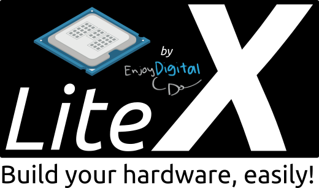</a>

See [6.litex/README.md](6.litex/README.md)

--------------------

# Project Status

- ✅ Procure Test equipment, test fixtures, dev boards and accessories

- ✅ Create docs and diagrams that are easy to follow and comprehend
>- ✅ RTL DLL and TL
>- ✅ PIPE
>- ✅ SW
>- ✅ TB, Sim, VIP

- 🟠 Design, debug and manufacture two flavors of EP cards
> Given the high-speed nature of this design, we plan for two iterations:
>- ✅ M.2  **RevA**
>- 🟠 Edge RevA

>- 🟠 M.2  **RevB**
>- ⬜ Edge RevB

 
- 🟠 Develop opensource PHY with PIPE interface for GateMate SerDes
>- ✅ x1, **Gen1**
>- ⬜ x1, Gen2 (best-effort, consider it a bonus if we make it)

- 🟠 Develop opensource RTL for PCIE EP **DLL function**, with PIPE interface
- 🟠 Develop opensource RTL for PCIE EP **TL function**

- 🟠 Create comprehensive co-sim testbench

- ⬜ Develop opensource PCIE EP Demo/Example for PIO access
> - ⬜ Software driver and TestApp
> - ⬜ Debug and bringup

- 🟠 Implement it all in GateMate, pushing through PNR and timing closure
> - 🟠 Work with nextpnr/ProjectPeppercorn developers to identify and resolve issues

- ⬜ Port to LiteX

- ⬜ Present project challenges and achievements at (minimum) two trade fairs or conferences (see [Community Outreach](#community-outreach))

--------------------

### Acknowledgements

We are thankful to **NLnet Foundation** for unreserved sponsorship of this development activity.

   
   

This project was funded through the NGI0 Commons Fund, a fund established by NLnet with financial support from the European Commission's Next Generation Internet programme, under the aegis of DG Communications Networks, Content and Technology under grant agreement No 101135429. Additional funding is made available by the Swiss State Secretariat for Education, Research and Innovation (SERI).

### Partners and Contributors

  
  <a href="https://radiona.org">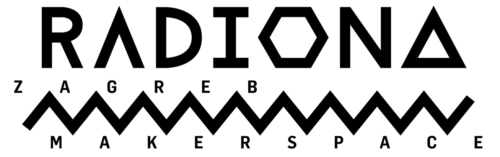</a>

   

  <a href="https://colognechip.com">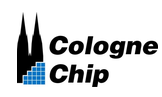</a>
  <a href="https://colognechip.com/programmable-logic/gatemate">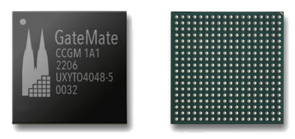</a>

**wyvernSemi**'s wisdom and contribution meant a world of difference -- Thank you, we are honored to have had you on the project!

  <a href="https://github.com/wyvernSemi">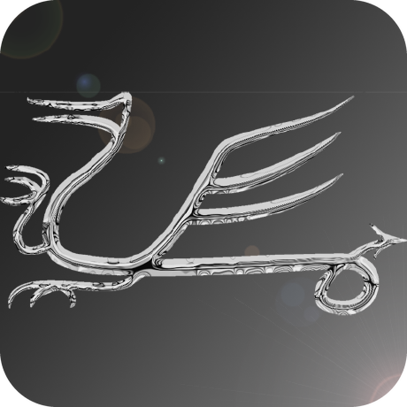</a>

  <a href="https://github.com/chili-chips-ba/openPCIE">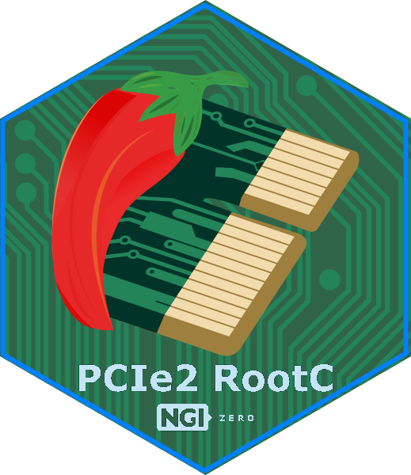</a>
  

   
   
   

  

  
  
  
  
  

  
  
  
  <a href="https://peakrdl.readthedocs.io">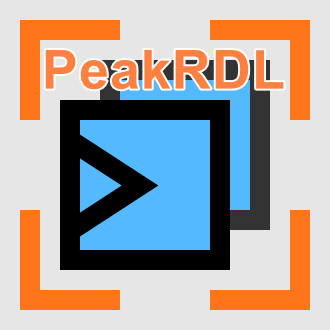</a>
  
  
  <a href="https://github.com/tarik-ibrahimovic/eduBOS5">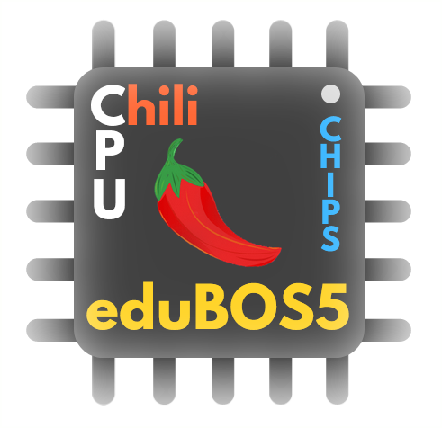</a>
  
  
  <a href="https://www.ngscopeclient.org">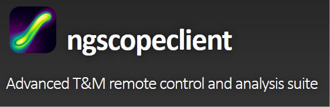</a>

--------------------

### Community Outreach

It is in a way more important for the dev community to know about such-and-such project or IP, than for the code to exist in some repo. Without such awareness, which comes through presentations, postings, conferences, ..., the work that went into creating the technical content is not fully accomplished.

Our posts so far:
- [2026-10-20, LinkedIn (Ferrite)](https://lnkd.in/p/g-yGBEU8)
- [2026-10-17](https://www.linkedin.com/posts/chili-chips_having-too-much-fun-cracking-ones-and-zeros-activity-7517129808020074496-Rmev?utm_source=share&utm_medium=member_desktop&rcm=ACoAAAJv-TcBSi_5ff0VNMrInrT-xg44YF3jnyU)
- [2026-09-17](https://www.linkedin.com/feed/update/urn:li:activity:7505843991876370432?commentUrn=urn%3Ali%3Acomment%3A%28activity%3A7505843991876370432%2C7505869378253578240%29&replyUrn=urn%3Ali%3Acomment%3A%28activity%3A7505843991876370432%2C7505896426162274304%29&dashCommentUrn=urn%3Ali%3Afsd_comment%3A%287505869378253578240%2Curn%3Ali%3Aactivity%3A7505843991876370432%29&dashReplyUrn=urn%3Ali%3Afsd_comment%3A%287505896426162274304%2Curn%3Ali%3Aactivity%3A7505843991876370432%29)
- [2026-06-23](https://www.linkedin.com/posts/andrew-e-wilson_its-fun-bringing-all-the-fpga-vendors-together-share-7475267075234607104-j50-)
- [2026-06-12](https://www.linkedin.com/feed/update/urn:li:activity:7471157152074694656?commentUrn=urn%3Ali%3Acomment%3A%28activity%3A7471157152074694656%2C7471308573994557441%29&dashCommentUrn=urn%3Ali%3Afsd_comment%3A%287471308573994557441%2Curn%3Ali%3Aactivity%3A7471157152074694656%29)
- [2025-11-20](https://www.linkedin.com/feed/update/urn:li:activity:7394569666557366272?commentUrn=urn%3Ali%3Acomment%3A%28activity%3A7394569666557366272%2C7397466385519448064%29&dashCommentUrn=urn%3Ali%3Afsd_comment%3A%287397466385519448064%2Curn%3Ali%3Aactivity%3A7394569666557366272%29)
- [2025-10-02](https://www.linkedin.com/feed/update/urn:li:activity:7379769413421559808)
- [2025-08-25](https://www.linkedin.com/feed/update/urn:li:ugcPost:7362742908170473473?commentUrn=urn%3Ali%3Acomment%3A%28ugcPost%3A7362742908170473473%2C7363111076936232962%29&dashCommentUrn=urn%3Ali%3Afsd_comment%3A%287363111076936232962%2Curn%3Ali%3AugcPost%3A7362742908170473473%29)

We also plan on putting time and effort into community outreach through multiple venues. One of them is the presence at industry fairs and conferences, such as:

- **[Electronica 2026, Munich](https://electronica.de/en)**
> It is very likely that Cologne Chip will have a booth. There is also a conference track.

- **[Embedded World 2027, Nuremberg](https://www.embedded-world.de/en)**
> This is a trade fair where Cologne Chip will host a booth! This trade show also features a conference track.

- **[FPGA Developer Forum 2027, CERN, Geneva](https://indico.cern.ch/category/17799)**
> Cologne Chip is a sponsor. They might get a few presentation slots.

- **[FPGA Conference 2027, Munich](https://www.fpga-conference.eu)**
> Cologne Chip is one of the sponsors and therefore gets at least 2 presentation slots.

We are fully open to consider additional venues -- Please reach out and send your ideas!

--------------------

### Community Involvement

Feel like helping opensource PCIE community grow better and larger?! See [Contributions](CONTRIBUTING.md).

Don't feel shy to reach out and ask for help ===> .

--------------------

### Future outlook

Reflecting on our roadmap and possible future growth paths, in addition to the aforementioned DMA and porting to other FPGA families + ASICs, we are also thinking of:

- enablement of hardware acceleration for AI, video, and general DSP compute workloads
- bolting our PCIE EP to [ztachip](https://github.com/ztachip/ztachip), to then look into acceleration of the PC host Python
> This borrows from Xilinx PYNQ framework and Alveo platform, where programmable [DPUs](https://www.amd.com/en/products/adaptive-socs-and-fpgas/intellectual-property/dpu.html) are used for rapid mapping of algorithms into acceleration hardware, avoiding the time-consuming process of RTL design and validation. Such a combination would then make for the first-ever opensource "DPU" co-processor, and would also work hand-in-hand with our two new cards. After all, NiteFury and SQRL Acorn CLE 215+ M.2 cards were made for acceleration of crypto mining
- possibly also tackling the SerDes HM building brick. An opensource SerDes is in the works for the [GF180MCU](https://github.com/google/gf180mcu-pdk) process node. [wafer.space](https://wafer.space), who run shuttles on it, track that work and expect it in 6 to 9 months (as of October 2026).

--------------------

### GenAI

Our repo may contain elements of work facilitated by the modern GenAI tools , used under strict guidance and tight supervision of the blood-and-flesh developers, and solely as suggestions.

In the end, it is us, the human devs, who are fully responsible for any shortfalls you may uncover while tapping into repo resources.

--------------------
#### End of Document
